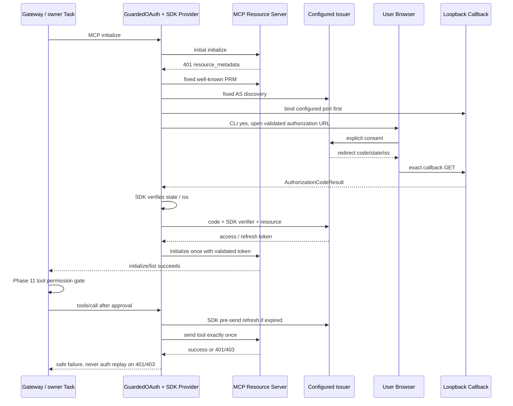

# Phase 14：MCP OAuth Authorization Code + PKCE

## 1. 学习目标与前置阶段

本阶段学习 OAuth 角色、授权码与PKCE、发现元数据、Resource受众绑定、浏览器Callback、内存TokenStorage、刷新/轮换，以及为什么“自动重新认证”不能等于“自动重放远端工具”。沿用Phase 12的legacy MCP Client与Phase 13的接收限制，只扩展HTTP认证边界。

环境为macOS/zsh、Python 3.12+、uv。以uv.lock和本地SDK源码为事实来源：mcp/mcp-types仍为2.3.0，httpx2仍为2.13.1，没有升级依赖或MCP协议。本阶段不实现动态注册、CIMD、Client Credentials、磁盘Token持久化、跨重启恢复、自动Scope扩展，也不新增Agent执行框架。

前置阅读：Phase 10的Manager/Adapter、Phase 11审批、Phase 12 owner Task/HTTPBoundary、Phase 13静态Bearer/ResponseLimitTransport。参考[MCP 2025-11-25授权规范](https://modelcontextprotocol.io/specification/2025-11-25/basic/authorization)、[RFC 7636 PKCE](https://www.rfc-editor.org/rfc/rfc7636)、[RFC 8707 Resource Indicators](https://www.rfc-editor.org/rfc/rfc8707)。这里实现的是受本地信任策略限制的OAuth授权码+PKCE子集，不宣称完整通用OAuth/OIDC Client兼容性。

## 2. 四个角色、认证和授权

- Resource Owner：在教学环境中明确点击Authorize的本地测试用户。
- Client：MyBot作为预注册公共Client，client_id可公开，没有client_secret。
- Resource Server：受保护的MCP Server，验证Access Token、受众、过期和Scope。
- Authorization Server：用户本地配置的Issuer，通过授权端点、Token端点签发/刷新令牌。

OAuth主要解决委托访问授权；Bearer证明持有者持有被服务器接受的凭证，不能据此把HTTP认证等同于用户身份的完整登录证明。本阶段没有OIDC ID Token。Phase 11仍负责Agent的**本地工具授权**：远端OAuth成功后，save_note仍须confirm，deny仍不注册且Manager直接拒绝。

## 3. Authorization Code、PKCE S256、state与iss

SDK生成随机code_verifier，并计算：

```text
code_challenge = BASE64URL_NO_PADDING(SHA256(ASCII(code_verifier)))
code_challenge_method = S256
```

授权请求携带challenge；用户同意后浏览器仅得到一次性Authorization Code，随后SDK使用verifier向已验证Token端点兑换Token。截获Code的人如果不知道verifier，不能完成兑换。Code不是Access Token，也不能直接访问MCP工具。

SDK同时生成随机state，Callback必须原样交回，SDK使用常量时间比较检测不匹配。授权响应的iss用于防止授权服务器混淆；SDK根据元数据中的authorization_response_iss_parameter_supported校验是否必须有iss及其Issuer。应用仅检查Callback结构，不代替SDK的state/iss验证，不生成或替换verifier/state。

实际源码在锁定SDK的mcp/client/auth/oauth2.py：`_perform_authorization_code_grant()`生成PKCE/state并验证Callback；`_exchange_token_authorization_code()`构建兑换请求；`_refresh_token()`构建刷新请求。项目没有复制这些协议实现。

## 4. 本地配置与预注册公共Client

配置片段见config/mcp.oauth.example.json，**它仅包含mcp块，不是完整config.json**。将其mcp块合入已有本地配置，并按需启用：

```json
{
  "type": "oauth_pkce",
  "issuer": "http://127.0.0.1:8766",
  "client_id": "mybot-mini-local",
  "scope": "notes:read notes:write",
  "redirect_uri": "http://127.0.0.1:43117/oauth/callback"
}
```

省略auth/none保持匿名；bearer_env保持Phase 13语义。stdio拒绝所有HTTP auth配置。validate_mcp通过validate_auth调用validate_oauth，在Manager建立任何连接前校验所有Server配置。

OAuth对象只允许上述五个字段。Issuer必须通过Phase 12 URL校验：无凭证/query/fragment，非回环必须HTTPS，HTTP仅字面量loopback。client_id为显式1–256字符ASCII标识（允许常见URL式字符，但不启用CIMD）。Scope为显式、唯一、空格分隔、最多512字符的OAuth Scope集合；禁止控制字符、引号和反斜线。Callback只允许`http://127.0.0.1:明确端口/oauth/callback`，不接受localhost、其他主机、任意路径或隐式端口。

MemoryTokenStorage预先提供OAuthClientInformationFull：配置的client_id、issuer、redirect_uris、token_endpoint_auth_method='none'。SDK不用动态注册取得Client信息；即使元数据公布registration_endpoint，应用也不发送注册请求。未知POST在网络前以oauth_registration_refused拒绝；把注册端点伪装成授权/Token端点也拒绝。

## 5. 发现、Issuer与Endpoint信任

Phase 13只允许单一MCP Endpoint；OAuthBoundary继承其资源请求约束，另分配以下独立白名单：

| 请求 | 允许目标和检查 |
| --- | --- |
| MCP Resource | 本地配置的精确Endpoint；只在这里注入此Server的已验证Access Token |
| Protected Resource Metadata | SDK按RFC规则从固定资源URL构造的路径级/根级well-known地址 |
| AS Metadata | SDK由本地Issuer构造的OAuth/OIDC well-known地址；必须先验证PRM |
| Token/Refresh | 已验证AS元数据公布的精确token_endpoint，且与配置Issuer同Origin |
| Browser Authorization | 已验证authorization_endpoint；同Issuer Origin，无配置外query/凭证 |
| Registration/其他 | 禁止 |

401中任意resource_metadata地址不自动加入白名单。PRM必须给出与配置Endpoint等价的resource，并只宣告配置Issuer。AS元数据的issuer必须匹配配置；比较使用httpx URL语义，允许等价的默认端口/根路径表示，不允许更换来源。authorization_endpoint、token_endpoint本身再次做URL校验并必须在同Issuer Origin，且互不相同、不等于公布的注册端点。跨Origin分离的合法AS部署也会被这个保守策略拒绝。

SDK可以按协议进行404发现回退，但不能回退到未配置Issuer或任意旧端点。AS缺少S256直接失败。SDK支持的PRM父路径resource比本项目更宽；本项目要求精确资源，不接受扩大到父资源。

请求hook清除Authorization、Proxy-Authorization、Cookie，发现/Token请求还清除MCP Session Header；Accept-Encoding固定identity。只有资源请求重注入当前Server存储已验收的Token。SDK会先赋值context.current_tokens，再调用storage.set_tokens，因此发送前还检查context Token就是storage已验收的同一快照，避免失败Token被清理DELETE意外使用。

全部请求保留trust_env=False、正常TLS证书校验、无netrc/环境代理、无自动网络重试；全部HTTP重定向均拒绝。模型和工具结果不能选择Issuer/URL/Token。浏览器只打开用户确认过的已验证授权端点；外部授权服务器自身的浏览器页面行为仍由该服务器控制，不能当作操作系统浏览器沙箱。

## 6. Resource Indicators与Scope边界

RFC 8707的resource表示令牌预期服务的资源/受众，不是LLM参数。本项目要求SDK的浏览器授权请求、授权码兑换请求、刷新请求均携带配置的MCP资源URL；缺少或不匹配就在发送前拒绝。PRM必须存在并匹配，确保SDK初始协议头尚未确定时也会包含resource。教学Resource Server同样检查Token记录中的resource，不接受其他受众的令牌。

SDK会按401 Challenge、PRM、AS元数据选择Scope，还可能自动追加offline_access；应用不修改该算法，而在打开浏览器前检查结果必须等于用户配置集合。超出、缺少或变更时Fail-Closed，要求用户核对明确配置/Server声明。Token返回Scope可以是配置集合的子集，但不能扩大；刷新返回Scope同样检查。没有自动Scope Step-Up；若服务器要求额外权限，应另行明确配置并重启授权。

## 7. Browser与一次性Callback

OAuthBoundary.redirect收到SDK生成的URL，核对Endpoint、client_id、redirect_uri、resource、Scope及S256，然后：

1. 创建OAuthCallback并先绑定127.0.0.1配置端口；端口冲突时不会打开浏览器。
2. CLI检查stdin为交互终端，显示可信授权端点、Client和Scope，接受用户本次yes确认。
3. 使用webbrowser.open打开SDK URL；不会打印含state/challenge的完整URL。
4. Callback等待结果，返回AuthorizationCodeResult(code,state,iss)，由SDK验证并兑换。

Callback仅接受精确Host和路径的GET，限制HTTP头8192字节、目标Query所在请求目标4096字符、参数数最多4、单值最多2048字符。拒绝重复code/state/iss、未知参数、非法百分号编码/UTF-8、控制字符、错误方法/路径/Host及重复使用。Authorization error单独安全失败。结构不合法的请求400，不完成本次Callback；第一个结构合法结果完成后不能再使用，SDK随后验证其真实性。

Callback返回固定文本，Cache-Control:no-store、Pragma:no-cache、Referrer-Policy:no-referrer、CSP default-src 'none'，不回显敏感参数。等待与CLI确认各有120秒上限，处理单个HTTP头5秒上限。EOF/拒绝、超时、Ctrl-C/取消、端口冲突均进入清理。

独立处理Task只接收HTTP请求，不进入/退出MCP SDK上下文。Python 3.12的server.wait_closed会等待活动连接，因此关闭顺序是先停监听、取消并回收处理Task，再等待server关闭；不能反过来等待慢请求自然超时。终端确认使用macOS事件循环add_reader，避免残留阻塞input线程。

## 8. TokenStorage、过期、刷新和轮换

每个OAuthBoundary独立创建MemoryTokenStorage，实现get_tokens/set_tokens/get_client_info/set_client_info。对象默认repr不包含内部字段；SDK Token类型本身是敏感对象，不应主动打印或序列化它/SDK context。Storage验收Token：Bearer格式、Access Token最多4096 ASCII字节、显式正expires_in、Scope不扩大；可选Refresh Token最多8192个可见ASCII字符。Client信息与本地Client/Issuer绑定，拒绝Client Secret。

SDK计算过期时间；过期且有Refresh Token时，在发送资源请求前向已验证Token端点刷新。刷新仍包含resource，由SDK处理新Token与Refresh Token轮换。真实测试证实连续两次刷新采用新Refresh Token，旧值被AS拒绝。刷新非成功响应由响应hook以oauth_refresh_failed中止，阻止SDK退回新浏览器登录并发送原工具。无Refresh Token且过期时，oauth_login_required在网络发送工具前失败；不匿名降级。

Gateway退出或失败后关闭HTTP Client、Callback，清除Storage和SDK context的Token/Client引用。不写磁盘、不使用Keychain/Secret Manager，不承诺Python内存可可靠擦除；重启或新Manager必须重新授权。/clear只清已有Session/Plan，不重新建立OAuth或重放请求；它也不是远端撤销Token的接口。

## 9. 为什么工具401/403绝不自动重放

原SDK `_auth_flow()`收到401会内联发现/授权并yield原请求第二次；403 insufficient_scope也可能扩大Scope后重发。对initialize可以受控使用，对save_note/delete_note则可能重复远端副作用。

GuardedOAuth是httpx.Auth组合器，驱动原OAuthClientProvider.async_auth_flow生成器；在每次yield前检查目标、请求类型、resource和发送次数。它不构造PKCE、Token交换或刷新协议。只有**尚未成功初始化的首次initialize**可匿名发送并接受一次401认证，随后仅允许一次携Token重发。初始化成功后所有其他资源请求只可发送一次，且必须已有有效Token。

工具的401/403在response hook抛安全错误，发生在SDK收到response之前，所以SDK没有机会启动重新授权、Scope Step-Up或重放。发送次数检查是额外的保险。沿用Manager关闭全部MCP、审计安全错误及“远端副作用可能未知、无重试、需重启”的提示，不把HTTP失败当成没有副作用。

SDK另一个实际细节：OAuth context.lock跨越资源响应等待，Streamable HTTP退出却先DELETE后取消后台POST。如果取消一个挂起POST，再让DELETE等待同一OAuth锁，就会拖到POST超时。仅对这种锁占用的清理DELETE，适配器使用已验证、仍有效的凭证快照直接发送一次，不刷新/重新登录/重放；其他请求仍走SDK。Boundary仍清理并验证Header/Endpoint，无法安全清理时Fail-Closed并关闭本地连接；不承诺凭证失效后能删除远端Session。没有移动SDK连接owner Task或修改Manager生命周期实现。

## 10. 接收安全、日志与错误

Phase 13 ResponseLimitTransport未修改，同时包在OAuth HTTP Client底层。JSON元数据、Token响应、普通MCP JSON都受真实2MiB流式字节限制；不信Content-Length，超限块不交付，拒绝非identity压缩。元数据/Token和引发授权的401不得伪装成text/event-stream，否则SDK后续aread会绕过非SSE计数；这种响应读取前即oauth_response_type_refused。合法资源SSE继续SDK单事件1MiB限制，不累计整条流。

沿用quiet_wire_logs临时关闭SDK/network正文日志；SDK状态不匹配和Token错误可能把state或响应正文放进异常，所以GuardedOAuth将SDK异常替换为固定oauth_flow_failed。Issuer/Endpoint/Resource/S256/Scope等应用拒绝使用独立固定类别；Callback使用oauth_callback_timeout/bind_failed等；工具401/403继续http_401/http_403。报告不带原始外部异常、Header、Body、Code或Token。

Authentication/transport凭证不注入Tool Schema、LLM消息、Function Calling参数、Session或审计。Session仍会保存用户自行提供的工具参数和结果；服务器已知道Token且可以保存/反射收到的信息，项目不能把服务端可信度当作OAuth或TLS的保证。

## 11. 完整调用关系



Agent工具链保持：AgentLoop → ToolRegistry → MCPToolAdapter → Manager.call → 冻结/校验arguments → Phase 11 PermissionGate → SDK tools/call → OAuth-aware HTTP Client → Resource Server。OAuth失败不是Plan成功证据；Tool Call ID配对与/clear行为保持原实现。

## 12. 核心文件与关键入口

| 文件 | 关键入口/职责 |
| --- | --- |
| mybot/mcp_client/oauth_config.py | validate_oauth：启动网络前校验本地信任配置 |
| mybot/mcp_client/credentials.py | validate_auth分派OAuth；静态Credential Provider保持隔离 |
| mybot/mcp_client/oauth.py | MemoryTokenStorage、OAuthBoundary、GuardedOAuth；SDK组合与发送边界 |
| mybot/mcp_client/oauth_callback.py | OAuthCallback.start/handle/wait/close、open_authorization |
| mybot/mcp_client/transport.py | connect_transport选择OAuth Client，finally回收OAuth状态 |
| scripts/mcp_oauth_demo_server.py | DemoOAuth、create_apps、main：两个真实回环服务 |
| scripts/check_mcp_oauth.py | 真实授权/刷新/权限/故障/Callback测试 |
| scripts/check_phase.py | 全量回归和归档自验证包含OAuth专项 |
| config/mcp.oauth.example.json | 可合入本地配置的mcp示例块，无凭证 |

未修改AgentLoop、Registry、Planning、Session、Manager、Adapter/Adapter.result、Approval及ResponseLimitTransport。依赖锁文件不变。

## 13. macOS + uv安装与运行

```bash
uv sync --frozen
# 终端A：只监听本机，生成合成短期Token；不需要任何真实OAuth凭证
uv run python -m scripts.mcp_oauth_demo_server \
  --resource-port 8765 --issuer-port 8766 --callback-port 43117
```

终端B：

```bash
cp config/config.example.json config/config.json
# 编辑真实本地配置：将config/mcp.oauth.example.json的mcp块合入，并设置enabled=true
# 只保留需要的Server；示例OAuth Client已在教学AS预注册
# 交互运行需自行配置LLM；下方命令可能调用用户配置的真实模型
uv run python mybot/main.py
```

Gateway启动时显示可信授权端点、Client和Scope；输入yes后浏览器显示“Local test user”授权页面，点击Authorize完成回环Callback。授权成功才完成MCP初始化与发现。save_note/delete_note仍需独立的本次工具确认；退出Gateway不会终止独立Demo Server。Demo使用30秒Access Token和内存Refresh Token，刷新不需要第二次浏览器授权。

自动化验证不需要真实模型或实际打开浏览器：

```bash
uv run python -m scripts.check_mcp_oauth
uv run python -m scripts.check_phase
uv run python -m scripts.test_phase_archives
uv run python -m compileall -q mybot
```

测试只替换“用户是否确认并打开浏览器”这个UI入口，用本地HTTP Client读取授权页、显式POST同意、访问真实Callback；PKCE、state、Token兑换、刷新均为实际SDK+HTTP协议，没有固定OAuthClientProvider返回值。

## 14. 教学Server的范围

Resource和AS各自只监听127.0.0.1。预注册mybot-mini-local，精确redirect_uri；授权页需显式Authorize。AS验证S256、一次性Code（60秒内有效）、Client/redirect/resource，签发内存不透明Access/Refresh Token；Access默认30秒，Refresh轮换后旧值失效。Resource拒绝过期或错误受众Token，Scope不足返回403 insufficient_scope；继续复用五个进程内笔记/算术工具，不写私人文件。

普通日志不输出授权URL参数、Code、Verifier或Token。Demo缺乏生产用户身份体系、持久化、完整撤销/限流/防滥用/多租户隔离；进程内笔记和令牌在退出后丢失。它是教学与本地协议验证环境，不是生产OAuth身份服务。客户端没有自行签发Token；只有教学Authorization Server按其角色生成测试Token。

## 15. 实际测试结果

52项OAuth专项（48项HTTP/SDK/Agent集成、4项Callback检查）通过；Phase 1–14共274项unittest及Phase 1/2既有断言通过。归档安全检查、ZIP与独立还原的冻结安装/编译/全量回归最终结果记录在AI_HANDOFF.md。

验证要点：

- 首次initialize两次发送（匿名401、认证后成功），随后POST/GET/DELETE认证；PRM/AS发现无身份Header；从未注册Client。
- 错误state、错误iss、声明必需却缺少iss均由SDK拒绝，错误state不发生Token兑换；真实AS确认challenge/verifier匹配、Resource正确。
- 错误verifier兑换失败；正确Code第一次200、重用400；过期Access Token不能访问Resource；实际签发但受众错误的Token不能完成初始化。
- 连续两次过期刷新成功并轮换Refresh Token；旧Refresh Token400。刷新失败/返回更大Scope安全失败，不再打开浏览器、不发送工具；无Refresh Token时也不匿名发送。
- 认证成功后拒绝保存，无远端保存调用且无笔记；批准保存后能读到内容；deny隐藏且Manager拒绝。
- save_note已产生实际副作用后返回401，只执行一次；delete_note实际删除后返回403 insufficient_scope，只执行一次；各自只有首次浏览器授权，没有Scope Step-Up。重建Manager后读状态确认实际副作用。
- Agent的Tool Call ID正确配对，失败不成为Plan成功证据，/clear无新授权或工具请求。DEBUG/模型请求/Schema/内存与临时磁盘Session/审计未注入Token、Code或state。
- 两个独立Issuer/Resource各自授权、各自存储，首次请求均不携带其他Server凭证；stdio、静态Bearer、OAuth三个Server共存。
- 大元数据/Token响应2MiB拒绝，压缩拒绝，元数据伪装SSE拒绝；合法资源SSE正常。取消Callback/工具、端口冲突、EOF/拒绝、慢HTTP头均释放监听/Client，退出清除内存引用。
- 真实生产Demo CLI双端口启动和完整协议通过；Uvicorn显式ASGI3，避免绑定方法被自动识别成ASGI2而返回500。

所有测试使用合成令牌、真实本地SDK/HTTP、离线模拟模型；未调用真实LLM API，未连接第三方OAuth Provider或公网TLS服务。

## 16. 常见问题与明确限制

- oauth_interaction_required：需在交互终端重新启动Gateway授权；不会静默打开浏览器或从Session恢复Token。
- oauth_callback_bind_failed：关闭占用43117的程序，或同时修改Client本地redirect和Demo预注册callback端口；不能临时接受Server建议的未知Callback。
- oauth_issuer/resource/endpoint_refused：检查本地Issuer、MCP Endpoint与发现文档。合法跨Origin Token端点、任意PRM位置、父资源Token也可能因保守边界被拒绝。
- oauth_authorization_request_refused：SDK按Server信息选出的Scope与本地显式集合不同（包括自动追加offline_access）；不要自动扩大Scope来绕过，需要用户核对配置和Server声明。
- oauth_flow_failed：SDK拒绝state/iss或协议数据等，只报告固定类别；不会打印原始敏感异常来排错。
- oauth_refresh_failed/oauth_login_required：本次操作终止，重启Gateway重新授权；HTTP401/403不重放已经发送的写操作。
- oauth_token_refused：本阶段要求明确正expires_in及有界Bearer/Refresh值；不支持不提供过期信息的Token。
- 超时/取消/认证错误仍可能已产生远端副作用，不能靠重新授权回滚。清理DELETE是尽力而为，凭证失效时不保证服务端立即删除Session。
- 内存存储不是Vault，环境/进程调试器仍可能读取秘密；服务端可能保存/反射收到信息。TLS不保证服务端行为可信，认证不替代工具审批。
- 固定回环Callback仅macOS/当前asyncio事件循环验证；无动态端口协商、跨设备登录、Token持久化、OAuth撤销流程或通用浏览器内容隔离。
- 日志抑制沿用Phase 12进程级单Gateway约束；非SSE2MiB和SSE单事件限制不是完整DoS沙箱。
- ExFAT会生成AppleDouble `._*`；确认文件头后才清理，复制使用COPYFILE_DISABLE=1，归档不含此类条目，优先APFS验证；不能承诺系统完全不生成。

## 17. Phase 13 → 14与独立归档

Phase 13的none/bearer_env和单一MCP资源边界保留；新增oauth_pkce、受控发现目标、浏览器授权、内存存储和SDK刷新。扩大的是明确验证后的OAuth网络目标集合，不是工具权限或Agent能力。没有实现Phase 15。

```bash
# 本阶段提交且验证完成后，在干净独立工作树中执行，不覆盖Tag/ZIP
bash scripts/save_phase.sh 14 "MCP OAuth Authorization Code and PKCE"
bash scripts/restore_phase.sh 14
cd ../mybot-mini-learning/phase-14
uv sync --frozen
uv run python -m compileall -q mybot
uv run python -m scripts.check_phase
```

Tag为annotated phase-14，ZIP为../mybot-mini-snapshots/phase-14.zip，完整源码/锁文件/示例/学习资料/离线测试均包含。主工作区用户app.py、USER.md修改不纳入归档，真实config、Session、Callback数据和Token不提交。不移动旧Tag、不覆盖旧ZIP，不自动Push。归档和还原最终结果以AI_HANDOFF.md及Git记录为准。

archive-ready: true
