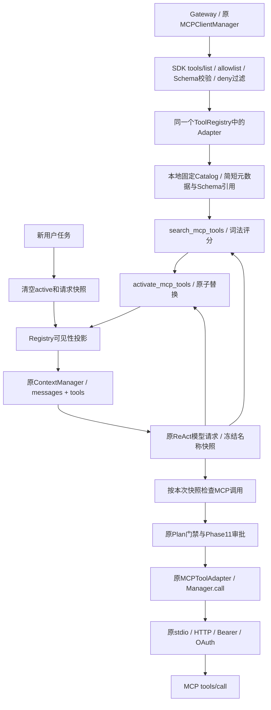

# Phase 15：MCP Tool Discovery & Progressive Disclosure

## 1. 学习目标与阶段边界

本阶段解决“已经连接并允许调用的MCP工具，何时把完整Schema放入模型请求”这一问题。学习Catalog、关键词Search、原子Activate、可见性投影和请求快照，并理解它们与执行授权、Planning证据和Context预算的区别。

沿用macOS/zsh、Python3.12+/uv、MCP/mcp-types2.3.0和原Client(mode='legacy')。不升级依赖，不增加模型分类请求、Embedding、向量库、独立ReAct循环、动态启动Server、list_changed热更新、程序化编排或模型代码执行。AgentLoop仅在原请求/执行/清理位置做小范围扩展，没有第二个ToolRegistry。

前置阅读：Phase10工具Adapter和发现，Phase11审批，Phase12–14传输/Bearer/OAuth，Phase4计划证据，Phase6上下文预算及Phase7 Skills。

## 2. tools/list、Catalog与Progressive Disclosure

MCP tools/list是网关初始化时向每个配置Server发现定义的协议请求。Manager仍进行分页、allowlist、Schema验证、命名空间和权限过滤，将允许的Adapter注册到原Registry。搜索不是再次tools/list，激活也不重建连接。

eager模式每次请求发送全部注册工具定义。工具越多、参数描述越长，messages + tools占用的上下文字符就越多；一个只需查询项目任务的请求仍会携带无关的日程、文档和数据工具。

progressive模式采用三层：

| 层 | 保存/返回什么 | 是否执行远端工具 |
| --- | --- | --- |
| Catalog | 通过验证的Adapter引用、全名/Server/简短描述、关键词及完整Schema字符计数 | 否 |
| Search | 有界候选name/server/description | 否 |
| Activate | 替换当前任务的已激活名称集合 | 否 |

完整Schema只在后续模型请求中暴露。所有MCP连接仍在启动时建立，完整定义仍在本地内存；本阶段节省的是模型请求里的无关Schema，并没有减少初始化网络发现量或实现懒启动。

## 3. 配置、默认行为和范围

```json
{
  "mcp": {
    "enabled": false,
    "discovery": {
      "enabled": false,
      "max_active_tools": 4,
      "max_active_schema_chars": 12000,
      "search_limit": 5
    },
    "servers": {}
  }
}
```

GatewayConfig新增mcp_discovery，并在启动连接前调用validate_discovery。省略discovery保持关闭，缺省字段补齐；未知字段、错误类型和bool冒充整数均拒绝。允许范围：max_active_tools为1–64，max_active_schema_chars为256–200000，search_limit为1–20。模型没有修改这些配置的工具。

关闭时仍使用Phase14 eager方式，搜索/激活元工具不会注册。开启只改变MCP可见性，内置文件工具、Planning、已启用的Skills及两个Discovery工具一直保留；即使没有MCP工具，也可正常执行内置任务并返回空搜索结果。不自动修改真实config/config.json。

max_active_schema_chars仅针对当前激活的**完整MCP工具定义数组**：使用与ContextManager相同的json.dumps(..., ensure_ascii=False)字符口径，包含function名称、描述、parameters及数组分隔开销。空集合计0；不是Token数，也不包含内置/元工具、消息或协议包装。请求总体仍受既有ContextManager另行检查。

## 4. Catalog结构与信任

MCPToolCatalog从Registry.iter_tools()取得已注册Adapter引用，仅索引MCPToolAdapter，复核remote_name在其Manager的allowed_tools中且策略不是deny。deny工具原本也不会注册，Catalog不从Manager私有全量Adapter集合暴露它们。

CatalogEntry保存全名、Server、最多240字符的简短描述、Adapter引用、Schema长度和三个关键词集合。Adapter不参与Entry的repr，不保存/序列化其认证配置。完整Schema仍由原Adapter生成，required、enum、嵌套约束均保持，不为了预算裁剪。Catalog是元数据索引，不是另一个可执行Registry。

描述合并空白、移除控制字符后有界截断。它始终是不可信工具元数据，搜索返回JSON Tool Result，不转为System指令，也不解析为脚本、权限或自动激活命令。Catalog不读取URL、Token、凭证配置；但服务器本身可以把任意内容写进描述，不能把有界元数据误认为通用秘密脱敏器或防提示注入沙箱。

目录是Agent创建时的快照。后续私自注册的新MCP Adapter也不会自动进入可见集合或获得激活能力，需要新建Catalog/Gateway；本阶段没有list_changed订阅或热更新。

## 5. search_mcp_tools如何搜索

参数只有query；要求1–256个可打印字符且至少含关键词，不接受未知参数、换行或无意义标点。关键词通过Unicode字母/数字分词，casefold归一化，以下划线等分隔，去重后进行集合匹配。

```text
score = 6 × 名称匹配词数 + 3 × Server匹配词数 + 1 × 简短描述匹配词数
sort = 分数降序，完整工具名升序
```

完整名称中也包含Server名称，权重因此是可解释的简单词法偏好，不是语义相关概率。相同输入和目录排序稳定；只有正分候选，最多search_limit项，每项只含name/server/description，没有完整Schema或配置。无匹配时明确返回matches=[]和No matching MCP tools；不扩大权限，不回退暴露全部工具。

例如query='project tasks'首先找到mcp__catalog__list_project_tasks；query='architecture'可由描述找到search_documents。query='项目任务'无法映射英文描述，返回空是正常局限。没有同义词、词干、跨语言Embedding或真实模型相关性评价。

搜索不调用LLM、MCP tools/call或审批提供者，不新增Manager审计事件，也不记录原始query到默认审计。可选DEBUG会隐藏Discovery参数。与其他工具一样，搜索调用参数和返回结果仍可进入canonical Session，开启持久化时可能写盘；这不是审计脱敏承诺。

## 6. activate_mcp_tools的替换与原子性

```json
{"names": ["mcp__catalog__list_project_tasks"]}
```

names最多128个长度1–64的字符串，先去重，再验证全部名称、激活数量和完整Schema字符预算。只接受当前目录中允许的MCP工具，不能激活内置文件工具、Planning、Skill、元工具、deny或未知名称。空数组清空集合。

只有全部通过才一次赋值active=frozenset(names)。未知名称、超数量、超Schema均拒绝且保留旧集合；重复名称不会形成重复Schema。每次请求**替换**旧集合，防止无限累积。

成功结果只有active名称、字符数和“下一模型请求可见”的提示，不返回Schema、不调用业务、不请求审批，更不授予allow/confirm权限。Gateway启动时已有连接和定义，激活不触发新的远端发现。

## 7. Registry的可见性投影

ToolRegistry新增get_definitions(visible_names=None)、get_tool、iter_tools和is_metadata。无参数仍按原注册顺序返回所有定义；传入集合时只过滤，不删除、不重新注册工具，也不改变参数Schema。过滤后的相对顺序保持稳定，未知筛选名称不会创建工具。

Catalog.visible_names()取所有非MCP工具与当前激活名称的并集。Agent每次模型请求重新生成definitions，调用原ContextManager.prepare后送到既有client.chat.completions.create。内置工具、计划、Skills（若启用）和search/activate一直可见。

Schema在请求时从原Adapter.to_schema生成；目录只缓存其验证后静态定义的长度。本阶段不支持在运行中原地修改Adapter参数/描述；这样的本地修改也不属于远端热更新接口。

## 8. 为什么需要每次请求的可见性快照

模型一次可能返回多个Tool Calls：

```text
请求N只暴露元工具
响应N：activate(A)，call(A)
```

activate改变的是下一次请求的集合。call(A)在生成响应N时没有看到A的Schema，必须失败；否则模型只要猜出名称就能把激活和执行合并，绕过渐进暴露边界。

Agent在发出每次模型请求前，用实际definitions生成frozenset快照_request_visible_names；处理该响应的整批调用期间不改变它。MCP执行路径同时检查“是真实MCP Adapter”和“在此次快照中”。不满足时返回mcp_tool_not_visible_in_request，不调用Manager/Server；下一次请求重新计算Schema后才能执行。

反例也得到验证：请求N已经暴露A，响应N先替换成B、再调用A，则A仍可执行，因为本次确实暴露过它；B仍需等下一次请求。由此避免把“执行时active集合”误当成“产生响应时真正暴露的集合”。

这只限制模型调用路径，可信本地代码仍能通过原Registry/Manager接口调用工具；原审批、参数验证和owner Task边界照常生效。不是操作系统沙箱，也没有新业务授权API。

## 9. 生命周期、Session和消息配对

每个handle_message开始清空激活和请求快照，finally再次清空，覆盖正常完成、异常、取消、模型超时、ReAct上限和上下文预算错误。/clear也走同一清理，并保留原Session/Plan清空流程。

Catalog可跨用户任务复用，active不跨任务、重启或Session恢复。Session会正常记录搜索/激活的Tool Call及结果，但不会保存/恢复可执行的active状态；旧历史里出现某名称不表示它在新任务可见。

未经暴露的调用生成普通失败Tool Result，保持Tool Call ID配对。Phase11审批拒绝仍使用原permission_denied批量收尾：本批后续所有调用得到取消结果，任务停止，已执行操作不自动回滚。搜索/激活没有额外循环，仍使用原max_react_steps（上限30），探索步骤也消耗该预算。

## 10. Planning中的元数据与执行证据

Tool默认provides_execution_evidence=True；PlanningTool、SkillTool和DiscoveryTool显式为False。Registry.is_metadata查询这个属性，而不是靠搜索/激活的字符串名称恰好匹配来决定证据。

Agent._execute对元工具直接走原参数校验和执行，不经过Plan.execution_error，也不调用Plan.observe。于是尚未启动步骤时可以搜索、激活；搜索成功、失败或激活成功都不把步骤标为verified，也不把纯元数据失败当业务执行失败。它们仍不能批准工具操作或完成update_plan。

业务工具沿用原计划门禁，执行结果继续进入Plan.observe；真实MCP成功才提供证据，失败继续遵循原步骤失败规则。本阶段没有修改Plan的顺序/完成/收尾算法，仅给PlanningTool增加显式角色属性，Skill原有“只读元操作”行为保持。

## 11. ContextManager与Skills

没有第二套ContextManager。eager请求计全部工具Schema；progressive计实际投影的Schema；搜索结果作为普通Tool Result进入messages；激活后的完整Schema进入下一请求的tools。两种模式都使用原json序列化字符统计、历史压缩和工具结果裁剪。

Catalog专用Schema预算通过也不代表整条请求能放下：ContextManager仍可能因为system/messages/其他工具而明确失败。不能静默丢弃required、裁剪活动Schema或重新暴露所有工具。搜索结果太长时，原裁剪标记及最终“不足以证明完整分析”声明照常生效；Session保留canonical原文，只有请求副本被裁剪。

Skills可选，不要求先加载Skill；无Skill不判失败。Skill可以建议搜索，但无权修改allowlist、激活预算、tool_policies或OAuth配置；load_skill不会自动激活/授权MCP工具。原Phase8/9 Evaluation基准现在显式关闭MCP及Discovery以保持隔离，评分器和task_success/process_clean/instruction_followed/strict_pass定义均未改变。新对比脚本单独衡量Discovery机制。

## 12. 35工具教学Demo

scripts/mcp_catalog_demo_server.py使用官方lowlevel.Server与真实stdio协议，五个类别各7个工具：project、documents、code、calendar、data。每个Schema具有明确必填主参数、状态/数量/偏移/格式/标签/排序等可验证约束和说明，足以测量全量注入开销。

目标工具：list_project_tasks返回固定TASK-1/TASK-2；search_documents返回DOC-1 Architecture handbook。其他工具返回确定的合成记录。Server在调用时也验证完整Schema。所有工具只读、无网络/文件/Shell/真实模型/真实凭证；stdio stdout仅MCP协议，不能把启动后没有普通文本误认为挂起。

配置片段config/mcp.discovery.example.json仅包含mcp块，已列出35项allowlist与只读allow策略，mcp.enabled仍false，discovery.enabled为true供显式启用测试。真实用户配置不自动修改。

## 13. 架构图与源码调用关系



核心入口：discovery.validate_discovery、MCPToolCatalog.__init__/search/activate/visible_names/reset；Registry.get_definitions/is_metadata；AgentLoop.handle_message的起始/finally清理、原循环definitions投影和_execute快照门禁。Adapter、Manager、审批、传输、OAuth和ResponseLimitTransport未改。

## 14. macOS + uv安装、配置与测试

```bash
uv sync --frozen
cp config/config.example.json config/config.json
# 本地编辑：将config/mcp.discovery.example.json的mcp块合入配置，设置mcp.enabled=true
# 真实交互需自行设置LLM配置；下方CLI可能调用用户配置的真实模型
uv run python mybot/main.py
```

MCP stdio Demo由Gateway启动，无需另起HTTP服务。不用Catalog Demo时也可只开启现有HTTP/Bearer/OAuth Server的discovery；认证登录与Phase11审批均不改变。

以下自动化无需模型API，也不修改用户文件：

```bash
uv run python -m scripts.check_tool_discovery
uv run python -m scripts.compare_tool_discovery
uv run python -m scripts.check_phase
uv run python -m scripts.test_phase_archives
uv run python -m compileall -q mybot scripts
```

对比脚本只向stdout输出统计JSON，不默认保存提示词、Token、Schema正文或日志。测试使用临时工作区、固定模拟LLM响应与真实SDK/Server；OAuth测试只模拟浏览器UI入口，复用Phase14本地授权流程，不访问第三方。

## 15. eager / progressive实际离线对比

同一35工具Demo、相同目标与参数、Context预算160000、max_react_steps=16、Skills关闭，固定脚本在eager直接调用，在progressive搜索→激活→真实调用。每次实际请求tools数组用len(json.dumps(tools, ensure_ascii=False))计字符；统计包括最后一轮回答请求，不含messages。初轮可见40=eager的35 MCP+3内置+2计划；7=progressive的3内置+2计划+2元工具。

| 任务 | 模式 | Catalog工具数 | 初轮可见数 | 初轮Schema字符 | 平均Schema/请求 | 累积Schema字符 | 模型请求 | search / activate | 真实业务调用 | 成功 |
| --- | --- | ---: | ---: | ---: | ---: | ---: | ---: | --- | ---: | --- |
| 项目任务 | eager | 35 | 40 | 58457 | 58457.00 | 116914 | 2 | 0 / 0 | 1 | 是 |
| 项目任务 | progressive | 35 | 7 | 2520 | 3320.00 | 13280 | 4 | 1 / 1 | 1 | 是 |
| 文档查询 | eager | 35 | 40 | 58457 | 58457.00 | 116914 | 2 | 0 / 0 | 1 | 是 |
| 文档查询 | progressive | 35 | 7 | 2520 | 3330.00 | 13320 | 4 | 1 / 1 | 1 | 是 |
| 两个类别 | eager | 35 | 40 | 58457 | 58457.00 | 175371 | 3 | 0 / 0 | 2 | 是 |
| 两个类别 | progressive | 35 | 7 | 2520 | 3668.57 | 25680 | 7 | 2 / 2 | 2 | 是 |

每个目标均核对实际Server结果中的TASK/DOC标识和Manager审计成功，不能只靠固定最终回答宣布成功。额外请求分别为+2、+2、+4。progressive在这些固定案例中减小了初轮和累计Schema字符，但多了模型轮次、消息和潜在延迟。actual_tokens/actual_cost均为null，未调用真实Provider，不能据此计算费用或宣称真实选工具准确率提高。

如果Provider支持前缀缓存，eager稳定的全量Schema与progressive变化的集合可能有不同缓存效果；工具顺序和激活切换都可能影响缓存命中。此脚本没有测缓存、真实Token、延迟或费用，也没有在不同模型之间比较能力。首轮更小不是任务成本更低的充分证据。

## 16. 专项、回归与实际结果

新增39项专项通过；Phase1–15共313项unittest及Phase1/2原断言通过。对比脚本三任务六组均成功；归档安全、独立ZIP/还原的最终验证记录在AI_HANDOFF.md。

覆盖配置默认/范围/未知字段、真实35工具发现、allowlist/deny/双Server、描述和查询边界、词法排序、无网络搜索/激活、原子替换及字符精确边界；原Registry定义不变；模型初轮投影/下一轮Schema/同批绕过拒绝/旧快照仍有效；新任务/clear/异常/取消/ReAct上限清理；元数据不成为计划证据、真实业务可完成计划；Skills/本地文件DIRECT；Context实际计量、总体预算失败、不裁Schema、搜索结果请求裁剪而Session原文保留；HTTP/Bearer/OAuth、审批拒绝配对与批准真实保存；旧Evaluation隔离和DEBUG query隐藏。

未调用真实LLM或第三方MCP/OAuth服务，未改变Phase9评分语义。新机制在真实模型自主检索/选择中的表现尚未得到验证。

## 17. 常见问题与限制

- 搜不到：使用名称/Server/英文描述中的字面关键词；不支持中英文同义词语义匹配，不因空结果扩大目录。
- 激活失败：核对完整命名空间、max_active_tools和完整Schema字符预算。单个Schema超过上限也明确失败，不截断必填约束。
- 激活后同批调用失败：是有意的快照约束，下一模型请求拿到Schema后再调用；激活不是执行或用户批准。
- 新任务又看不到工具：激活是任务级状态，Session历史里的操作结果不会恢复它；Catalog本身仍缓存有效定义。
- Context预算不足：工具专用预算通过不代表总请求可容纳，原ContextManager会停止，不能偷偷去掉Schema字段。
- 多工具场景步骤不够：搜索和激活也占max_react_steps；可以在一个请求中激活多个已知候选，但后续真实调用仍须来自下一轮快照，不增加隐藏模型循环。
- Server关闭后：Catalog仍是启动时的元数据快照，真实调用由原Manager失败关闭策略处理；没有懒启动/断线重连/list_changed热更新。
- 元数据可能恶意：描述不是系统指令，不会直接执行；仍需用户预先信任Server，模型解释元数据的风险不能靠关键词过滤彻底消除。
- 本阶段只管理模型可见性，真实权限仍由原allowlist、策略和人工审批决定；可信本地代码可以调用Registry，不是新沙箱。
- ExFAT可能自动生成`._*`并干扰compileall。仅确认AppleDouble头后清理；COPYFILE_DISABLE=1减少元数据，归档排除并优先APFS验证，不能承诺完全不生成。

## 18. Phase14 → 15与独立学习归档

Phase14完成认证安全，本阶段不改认证/网络边界；增加的是目录、元工具和模型可见性投影。Schema验证、工具调用参数、远端审批、Session配对、Context真实性规则继续复用；AgentLoop原循环、计划规则和Evaluation评分没有被另起一套实现。

```bash
# 从当前阶段已提交的干净独立worktree保存，不能覆盖已存在Tag/ZIP
bash scripts/save_phase.sh 15 "MCP Tool Discovery and Progressive Disclosure"
bash scripts/restore_phase.sh 15
cd ../mybot-mini-learning/phase-15
uv sync --frozen
uv run python -m compileall -q mybot scripts
uv run python -m scripts.check_phase
uv run python -m scripts.compare_tool_discovery
```

Tag为唯一annotated phase-15，ZIP位于../mybot-mini-snapshots/phase-15.zip，含完整源码、uv.lock、配置模板、35工具Demo和离线测试/学习资料；不含真实config、Session、Token、评测运行日志或用户未提交的app.py/USER.md。旧Phase1–14归档不变，不自动Push，不进入Phase16。

archive-ready: true
