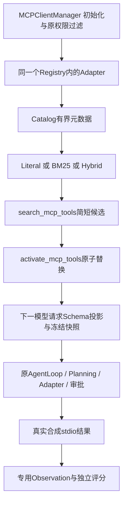

# Phase 16：MCP Tool Retrieval & Real-Model Evaluation

## 1. 学习目标与边界

Phase15解决“哪些完整工具定义进入当前模型请求”，本阶段解决“如何找候选、如何客观测量整个任务”。工具多会挤占上下文，名称相似也增加选择和参数混淆；减少Schema不保证减少总请求、费用或失败。

本阶段保留原AgentLoop、Registry、Planning、Session、ContextManager及Phase11–14安全边界。新增检索索引和独立合成Agent Harness；不修改Phase9的task/process/instruction/strict评分。默认全部离线；开发、回归、归档均不运行Live。未访问真实第三方MCP。

## 2. 三种检索器

`mcp.discovery.retrieval_mode`可选literal/bm25/hybrid，缺省解释为literal，不向旧默认对象强插入新键。类型、模式和多余字段严格校验。配置示例：

```json
{"mcp":{"enabled":false,"discovery":{"enabled":false,"retrieval_mode":"literal","max_active_tools":4,"max_active_schema_chars":12000,"search_limit":5},"servers":{}}}
```

只改变本地Catalog的候选排序。Catalog仍只取已注册、allowlist且非deny的MCPToolAdapter，复用名称、Server、240字符描述；不索引Schema、真实项目文件、评测Gold或凭证，不再执行tools/list。返回仍只有name/server/description，数量和256字符query限制沿用Phase15。

Literal保持Unicode casefold、去重词集合、名称6/Server3/描述1命中数和完整名排序。中文连续查询无法直接匹配英文元数据，是有意保留的基线。

## 3. BM25原理和实现

`retrieval.py`是纯Python静态索引。英文按Unicode词边界拆分，下划线、连字符、空格分开，casefold；中文连续串产生单字和相邻双字片段，既能确定性处理中文，也不会凭空翻译英文。三个字段分别保存Counter、长度及平均长度；DF按包含该词的工具文档数计算，同一工具跨字段只计一次。

固定`k1=1.2, b=0.75`，字段权重`6/3/1`，无调参追逐本次Gold。对查询去重词q、字段f和工具d：

```text
IDF(q) = log(1 + (N - df(q) + 0.5)/(df(q) + 0.5))
length_norm(d,f) = 1 - b + b * length(d,f)/average_length(f)
score(d,Q) = Σq Σf weight(f) * IDF(q) * tf(q,d,f)*(k1+1)
                                  / (tf(q,d,f) + k1*length_norm(d,f))
```

TF提高相关性但逐渐饱和；稀有词IDF较高；长度归一化避免长描述仅因词多占优。不存在的词IDF为0，无命中不返回候选，分数相同按完整名升序。查询评分最多128个去重词。此实现是加权字段BM25求和，不宣称与Lucene逐位相同，也不是完整BM25F。

正值IDF公式和默认参数参考[Lucene BM25Similarity官方文档](https://lucene.apache.org/core/9_12_1/core/org/apache/lucene/search/similarities/BM25Similarity.html)；原理参考[Robertson与Zaragoza的BM25综述](https://www.staff.city.ac.uk/~sbrp622/papers/foundations_bm25_review.pdf)。

## 4. Hybrid的受限双语扩展

词典独立放在`retrieval_aliases.py`，只有通用领域词，不含案例ID或目标工具全名。中文最长匹配，例如“查询项目未完成任务”可产生project/pending/task/tasks；英文使用整词别名/复数，中英混合可同时处理。不使用模型翻译、Embedding或远程搜索。

最多16次词典命中、32个去重扩展词；公式固定为`BM25(原始词) + 0.35 * BM25(扩展词)`，原始证据保持全权重。精确证据有优先权但不能保证每个原始命中永远排名第一；中文案例中search_project_tasks可能排在list_project_tasks之前，正确目标进入前5仍可召回。

这不是跨语言语义向量搜索；“尚未结束的工作事项”“每日安排”等未扩展表达仍可能失败。不把不可信description视为指令，不因无结果暴露全部工具。

## 5. 调用链与核心文件



- `mybot/mcp_client/retrieval.py`：tokenize、expand_query、BM25Index.scores/rank；索引仅在Catalog建立时计算。
- `retrieval_aliases.py`：固定词典与扩展上限；`discovery.py`仅扩配置验证和排序分支，激活及可见性规则不变。
- `mybot/evaluation/tool_retrieval.py`：固定目录、数据加载、metrics、分组分母。完全不建立MCP连接。
- `mybot/evaluation/tool_agent.py`：Limits、MeasuringClient、MeasuredAgent、Observation、grade、evaluate、summarize；复用原循环和Manager，不实现第二套ReAct。
- `evals/tool_retrieval_cases.json`：36条排名案例；`evals/tool_agent_cases.json`：12条业务案例、独立Gold和明确offline脚本。
- `scripts/{evaluate,compare}_tool_retrieval.py`、`evaluate_tool_agent.py`：命令入口；两个check脚本加入原check_phase。
- Demo仅扩展三个工具的合成结果：CODE-1、EVENT-1、DATA-1及42行；35项工具的名称/描述/Schema和原TASK/DOC结果不变，Phase15测量不回退。

## 6. 排名数据与指标

36条固定合成案例覆盖英文直接匹配、中文、混合、同义词、相似工具、多相关项、模糊/无工具。32正例、4负例。每条包含case_id/query/relevant_tools/acceptable_tools/category/language/split。acceptable_tools显式记录可接受集合，本版等于相关集合；不随检索结果修改Gold。最后8条为保留表达，不据其失败继续扩词典；这只是小型内部合成集，不能宣称是独立外部盲测。

排名器只接收元数据与query；Gold只进入评分器，不注入搜索索引或Live Prompt。三个方法同目录、同案例、同search_limit=5。按language、category、split输出原始数和有效分母。

- Hit@K：前K有任一相关项则1。
- Recall@K：前K相关项数/全部相关项数，多目标不是只检查一个工具。
- MRR@K：前K首个相关项排名的倒数，无命中0。
- NDCG@K：二元相关性`Σrel_i/log2(i+1)`除理想排序DCG，理想项数为min(K,相关总数)。
- 负例不进入正例指标分母；独立报告空结果正确率和错误候选率。没有该类样本时为null。

实际离线结果如下，排名指标不能解释为Agent任务成功率。

<!-- retrieval-results -->

| 模式 | K | Hit | Recall | MRR | NDCG |
| --- | ---: | ---: | ---: | ---: | ---: |
| literal | 1 | 0.5625 | 0.5312 | 0.5625 | 0.5625 |
| literal | 3 | 0.5625 | 0.5469 | 0.5625 | 0.5504 |
| literal | 5 | 0.5938 | 0.5781 | 0.5703 | 0.5639 |
| bm25 | 1 | 0.5312 | 0.5156 | 0.5312 | 0.5312 |
| bm25 | 3 | 0.5938 | 0.5938 | 0.5625 | 0.5726 |
| bm25 | 5 | 0.6250 | 0.6250 | 0.5687 | 0.5847 |
| hybrid | 1 | 0.6875 | 0.6562 | 0.6875 | 0.6875 |
| hybrid | 3 | 0.8438 | 0.8438 | 0.7656 | 0.7855 |
| hybrid | 5 | 0.8750 | 0.8750 | 0.7734 | 0.8012 |

三种模式的4条负例空结果正确率均1.0、错误候选率0；小样本不保证一般无关查询能可靠拒答。

| 模式 | 语言 | 总数 | 正例分母 | 负例分母 | Hit@5 | Recall@5 | MRR@5 | NDCG@5 |
| --- | --- | ---: | ---: | ---: | ---: | ---: | ---: | ---: |
| literal | en | 19 | 17 | 2 | 0.8235 | 0.7941 | 0.8235 | 0.8008 |
| literal | mixed | 6 | 5 | 1 | 1.0000 | 1.0000 | 0.8500 | 0.8861 |
| literal | zh | 11 | 10 | 1 | 0.0000 | 0.0000 | 0.0000 | 0.0000 |
| bm25 | en | 19 | 17 | 2 | 0.8824 | 0.8824 | 0.8235 | 0.8426 |
| bm25 | mixed | 6 | 5 | 1 | 1.0000 | 1.0000 | 0.8400 | 0.8774 |
| bm25 | zh | 11 | 10 | 1 | 0.0000 | 0.0000 | 0.0000 | 0.0000 |
| hybrid | en | 19 | 17 | 2 | 0.8824 | 0.8824 | 0.8235 | 0.8426 |
| hybrid | mixed | 6 | 5 | 1 | 1.0000 | 1.0000 | 1.0000 | 1.0000 |
| hybrid | zh | 11 | 10 | 1 | 0.8000 | 0.8000 | 0.5750 | 0.6314 |

## 7. Agent Harness的执行与隔离

默认三组eager/progressive_literal/progressive_hybrid，可选progressive_bm25。每个案例、重复、模式创建全新临时Workspace、Registry、Agent、Session和MCP连接，Workspace初态均为空；原生文件工具只能访问该目录。覆盖本地配置的mcp.servers，仅以当前Python连接35工具本地Demo，绝不加载其他真实MCP Server。Session持久化、Skills、DEBUG关闭，不读取真实任务历史或个人instructions。

复用原ContextBuilder系统规则；模型只接收案例的相同prompt和真实工具定义/结果，不接收Gold、所需工具表或参数答案。各组共享Provider、模型、temperature=0.1、输出上限、Context预算、执行逻辑和超时。固定顺序seed=16对模式顺序做可复现洗牌；这是执行顺序的随机种子，不是Provider seed，也不消除模型随机性。可repeats重复，报告样本数。

MeasuredAgent仅覆写执行/收尾观测点，真正Function Calling仍在AgentLoop内执行；同一请求快照禁止同批激活后调用新工具。搜索/激活仍不是Planning执行证据；参数验证、审批、deny、Session配对、Context裁剪和完整Schema约束不变。

Offline使用明确固定脚本，逐轮检查工具可见性、配对及真实MCP返回事实。搜索没有目标候选时脚本停止，不能从Gold修复检索。脚本不能衡量真实模型是否会选对工具或自主规划。特殊无工具案例使用预声明答案；这不证明模型能拒答。

## 8. 成功判据与失败诊断

Gold包含所需工具、必要参数值、真实返回事实、最终所需标识符/数值、禁止的虚构ID。Observation短暂读取实际ToolResult和参数，只把布尔证据计入最终报告；原始参数、Prompt、输出不保存。任务不能仅因模型说“完成”而成功。

分别报告retrieval_success（候选覆盖目标）、activation_success（成功激活的历史覆盖）、tool_call_success（正确参数和实际结果、业务调用数量）、final_answer_correct、task_success。Eager和不需工具时检索/激活为null。激活历史覆盖是评测观测，不恢复运行授权状态。无工具简单问答不能无意义调用工具；简单算术要求精确4。

最终答案按合成ID/数值的ASCII词边界及禁止ID校验，TASK-10不算TASK-1。它不是通用自然语言事实审查器，不能识别所有否定、遗漏关系或自然语言同义表达；只适合当前可验证ID任务。task_success还要求真实步骤、配对、任务正常结束和计划完成。

主要/次要类别来源于Trace终止状态和结果：retrieval_miss、activation_failed、schema_budget_exceeded、tool_not_visible、wrong_tool_selected、invalid_tool_arguments、tool_execution_failed、planning_failed、context_budget_exceeded、react_limit、model_timeout、provider_unsupported、request_budget_exceeded、incorrect_final_answer、unknown_failure；总时间额外用total_time_exceeded。成功任务中已恢复的错误单列recovered_errors，不等同最终失败。不能仅从模型最终文字推断失败阶段。

请求/总时间预算中断标记incomplete，成功指标为null；报告保留所有计划样本，包括未开始的模式。只有同case/repeat的全部模式complete才进入paired_differences。各模式非配对成功率也提供completed/incomplete分母，不能拿未配对结果宣称公平差异。model_timeout与Provider不兼容属于已观测失败，继续记录后续案例，不自动修复或重试。

## 9. Live开关与预算

只有同时提供`--live --confirm-api-cost`才构造真实Client，缺一个拒绝；默认不运行。复用已有本地Provider配置的API Key，不进入报告。只对clone调用SDK `with_options(max_retries=0, timeout=...)`，每次真实API尝试前计数，整个运行共享预算，不能切Provider绕过。Client在finally关闭。

默认/允许范围：

| 控制 | 默认 | 范围 |
| --- | ---: | --- |
| max_cases | 12 | 1–15（当前内置12例） |
| repeats | 1 | 1–5 |
| max_requests | 240 | 1–2000，全运行共享 |
| max_output_tokens | 512 | 1–4096 |
| max_react_steps | 16 | 1–30 |
| context_max_chars | 160000 | 1–500000 |
| request_timeout | 10秒 | (0,60] |
| task_timeout | 15秒 | (0,120]，含连接生命周期 |
| total_timeout | 240秒 | (0,1800] |
| seed | 16 | 0–2^32-1，仅顺序 |

不支持工具调用时，结构化unsupported参数错误或缺失tool_calls结构报provider_unsupported；普通自由文本未调用工具仍按业务证据失败，不假装执行，不解析自由文本JSON补调用。Provider静默忽略tools时无法仅凭回答证明能力不兼容，因此不自动把普通选择失败都标为不兼容。

## 10. 超时与MCP owner Task

`evaluate → asyncio.timeout → async with MCPClientManager → agent.handle_message → Manager.call → __aexit__`始终在同一owner Task。不能在外面建立Manager后wait_for(handle_message)转移MCP调用Task。Agent原有wait_for仅包裹模型请求，没有把MCP调用转移过去。

预算deadline在每次API前检查，timeout包裹连接进入、任务和退出；同任务中传播取消并退出SDK。超时、外部取消测试检查Manager.closed/空clients、owner一致；不产生AnyIO cancel scope跨Task错误。没有自动重试业务操作，不保存半完成Session。

## 11. Usage、缓存、费用与延迟

优先读取实际response.usage的prompt_tokens/completion_tokens/total_tokens；支持对象或dict。缓存只读取prompt_tokens_details.cached_tokens，缺失为null，不写0；非法/负数/布尔Usage无效。未知Provider自定义字段不猜测映射，明确不可测。某请求失败或缺Usage会使相应累计Token为null，不按字符除系数估算。Offline所有Token和费用未知。

记录每次请求耗时列表及和、任务wall time（含stdio建立/清理）、工具调用/失败、search/activate/actual MCP次数、首轮和累计实际Schema字符。Schema字符不是输入Token或完整messages大小。报告记录Provider/model安全名称、Git提交、worktree_dirty、案例SHA256、Limits、模式、temperature和显式价格配置。无Git的独立ZIP可能commit=null，不能冒充具备Git历史。

价格只由用户显式JSON给出currency（三位大写）、input_price_per_million、output_price_per_million，可选cached_input_price_per_million。无硬编码当前模型价格。只有输入/输出/缓存Usage已知且缓存非零时有对应费率才计算：

```text
estimated_cost = ((prompt_tokens - cached_input_tokens) * input_price
                  + cached_input_tokens * cached_price
                  + completion_tokens * output_price) / 1_000_000
```

缓存数据缺失则保守返回null；已知缓存为0无需缓存费率。actual_cost始终null（未取得真实账单），estimated_cost只代表给定价格下的估算。请求次数/输出Token限制不能保证严格总费用硬限额。

## 12. 实际Agent离线结果

同12个案例、每组1次、36样本，无incomplete、12个完整配对。使用真实本地stdio和固定模拟模型，未调用真实LLM。

<!-- agent-results -->

| Mode | Success | Requests | Input Tokens | Output Tokens | 本地任务耗时合计 | Estimated Cost | 累计Schema字符 |
| --- | ---: | ---: | --- | --- | ---: | --- | ---: |
| eager | 12/12 | 25 | 未知 | 未知 | 4.524秒 | 未知 | 1461425 |
| progressive_literal | 11/12 | 49 | 未知 | 未知 | 4.451秒 | 未知 | 167123 |
| progressive_hybrid | 12/12 | 51 | 未知 | 未知 | 4.551秒 | 未知 | 175363 |

同一运行中tool_call_success/final_answer_correct分别也为12/12、11/12、12/12。实际业务调用分别13、12、13；search/activate分别0/0、13/12、13/13。Literal的agent-08纯中文检索未命中，主要retrieval_miss，次要activation_failed/incorrect_final_answer；没有隐藏该失败。

本地耗时是一次机器实测，包含stdio开销，波动正常，不能解释为API延迟优势。两个Progressive初轮7工具/2520 Schema字符，Eager初轮40/58457。请求更多但Schema更少，缓存对真正费用和延迟的影响未知。模型可能能并行搜索/激活，真实请求次数也未必等于固定脚本。

报告明确mode=offline、actual_tokens=null、actual_cost=null、live_task_success_rate=null；模拟Live路径测试只验证开关/计量，不是收费API实验。

## 13. macOS + uv运行

```bash
uv sync --frozen
# 原CLI保持不变，真实对话需自行配置Provider
uv run python mybot/main.py
# 以下均为离线，不需要API Key
uv run python -m scripts.evaluate_tool_retrieval
uv run python -m scripts.compare_tool_retrieval
uv run python -m scripts.evaluate_tool_agent
uv run python -m scripts.evaluate_tool_agent --modes eager,progressive_bm25
uv run python -m scripts.evaluate_tool_agent --max-cases 2 --max-requests 20 --save
uv run python -m scripts.check_tool_retrieval
uv run python -m scripts.check_tool_agent_eval
uv run python -m scripts.check_phase
uv run python -m scripts.test_phase_archives
uv run python -m compileall -q mybot scripts
```

`--save`仅写忽略的runs/evals/，时间戳+UUID且exclusive创建，不覆盖旧报告。默认stdout JSON，不存Prompt、回复、参数或异常正文；沿用Phase9可选合成产物语义，未扩展其留存开关。

仅当用户未来决定进行收费实验，才手动执行下面示例；本阶段未运行：

```bash
uv run python -m scripts.evaluate_tool_agent --live --confirm-api-cost \
  --max-cases 1 --repeats 1 --max-requests 12 --max-output-tokens 256 \
  --task-timeout 20 --total-timeout 60 --request-timeout 10 --save
# 可选 --prices /绝对路径/prices.json，价格自行核实，不能提交凭证或报告
```

## 14. 测试、限制和阶段变化

新增17项检索测试和24项Harness测试：TF饱和/IDF/字段权重/长度归一化、中文混合、权限过滤、负例分母/多目标NDCG、可复现排序；真实stdio三组流程、参数与返回事实、配对/可见性快照、无意义调用、隔离、预算/取消清理、SDK retry=0、缺Usage/缓存、估价、报告隐私/独占保存、Phase15基线不变。Phase11审批与HTTP/Bearer/OAuth边界由原全量回归继续验证。Phase1–16全量354项unittest、Phase1/2原断言、归档安全集成检查和mybot/scripts编译均通过；独立归档和还原已验证，详见末节。

算法局限：小词典不是语义理解，短metadata可能缺必要线索，中文字符片段有噪声，独立加权字段BM25也可能让常见或同义工具误排。小内部数据有领域偏差，不能推广为通用检索能力。未实现Embedding、list_changed、动态启动、自动编排或新权限系统。

评测局限：固定脚本不是自主模型；最终答案为ID/数值rubric而非通用事实验证；Provider Usage兼容字段有限；Live协议/费用/模型选择能力未实测；取消可以清理本地连接但不承诺撤销已发送API请求或已执行操作。静态工具定义、单Agent串行任务约束延续Phase15。

本阶段参考[BFCL论文](https://proceedings.mlr.press/v267/patil25a.html)对工具选择、参数有效性、多步执行与拒答分别评测的思想；没有复制其评分、数据或宣称取得BFCL成绩。

## 15. 独立归档与还原

实现、测试、学习文档与索引提交后，从干净APFS worktree执行：

```bash
bash scripts/save_phase.sh 16 "MCP Tool Retrieval and Real-Model Evaluation"
bash scripts/restore_phase.sh 16
cd ../mybot-mini-learning/phase-16
uv sync --frozen
uv run python -m compileall -q mybot scripts
uv run python -m scripts.check_phase
uv run python -m scripts.compare_tool_retrieval
uv run python -m scripts.evaluate_tool_agent
```

归档包含完整源码/锁文件/配置模板/案例/学习资料，不含真实配置、凭证、Session或运行报告。旧Phase1–15 Tag/ZIP不变，不混入用户app.py/USER.md修改；不Push、不运行Live、不进入Phase17。ExFAT上只清理经文件头确认的AppleDouble，COPYFILE_DISABLE=1可减少元数据但不能保证完全阻止；ZIP不含._*。

实际归档结果：唯一annotated `phase-16` 指向实现提交 `332e1b97b90c64735d0872bb69fd89b8b3765cf4`。`../mybot-mini-snapshots/phase-16.zip`共135条目，SHA256为 `bf011ed02be2ddeae40fa001c1658da6f7fb75ee049f6bff08a56160ec011f0f`。干净APFS worktree保存时独立冻结安装、mybot编译、354项回归及Phase1/2原断言通过；restore_phase.sh 16还原后再次冻结安装、mybot/scripts编译、354项及原断言通过。检索报告排序/指标完全一致，Agent评分/调用计数/Schema/Token空值/配对完全一致（本地计时和Git元数据自然不同）。还原目录编译前清理136个经文件头确认的AppleDouble。CRC/ZIP提交SHA/必要文件/无元数据及用户文件的已提交版本核对通过，旧15个Tag对象和ZIP哈希不变，临时worktree已移除。未运行Live或第三方MCP。最终归档记录另作文档提交，不移动阶段Tag。

archive-ready: true
