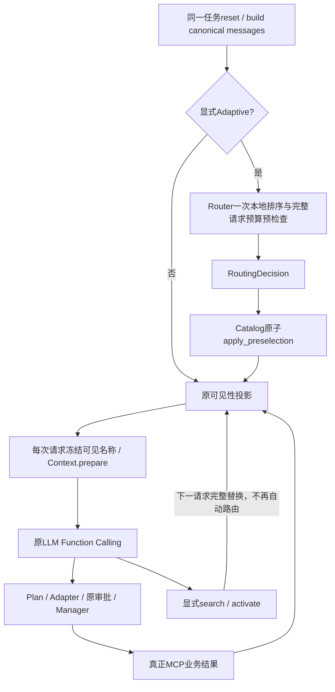

# Phase 17：Agent Adaptive Tool Routing

## 1. 学习目标

Tool Discovery让模型自己搜索候选、激活、再执行业务；Tool Routing让本地Harness在首个模型请求前，用当前用户任务和允许目录计算初始可见集合。它们都管理Schema可见性，不执行MCP业务，不等同授权。

本阶段不增加模型分类请求，不引入新Agent框架、Embedding、外部搜索、动态Server启动或第二个ReAct循环。新增代码复用Phase16检索器、Phase15可见性投影和原ContextManager。开发、测试、归档全部离线，没有真实LLM或第三方MCP/OAuth调用。

## 2. 三种方式与探索轮次

| 方式 | 首轮MCP Schema | 后续调整 | 代价 |
| --- | --- | --- | --- |
| Eager（discovery关闭） | 全部允许工具 | 原调用流程 | Schema可能很大 |
| Manual Progressive | 初始为空 | 模型search→activate→下一轮调用 | 探索增加请求 |
| Adaptive | 本地预算内预选 | 模型仍可search/activate完整替换 | 可能误选/漏选，仍可探索 |

在串行固定脚本中，单业务调用通常Eager需要2次请求（调用、最终答复），Manual需要4次（搜索、激活、调用、答复）；Adaptive覆盖目标时可省去探索。真实模型可能并行调用、主动继续搜索或选择错误，因此这不是对真实请求数的保证。

## 3. 配置及兼容

配置片段，不是完整config.json：

```json
{"mcp":{"enabled":false,"discovery":{
  "enabled":true,"retrieval_mode":"hybrid","routing_mode":"adaptive",
  "eager_tool_threshold":4,"preselect_limit":3,
  "max_active_tools":4,"max_active_schema_chars":12000,"search_limit":5
},"servers":{}}}
```

实际使用仍需配置可信Server并显式开启mcp.enabled；上面关闭MCP只是说明不会因添加路由字段就自动连接服务。不会修改用户真实config.json。

- routing_mode可选manual/adaptive，缺省manual；adaptive要求显式discovery.enabled=true，否则配置错误。
- discovery.enabled=false仍是原Eager行为，不隐式启用Router。
- eager_tool_threshold默认4，严格整数0–64；0禁用small_eager。
- preselect_limit缺省min(3,max_active_tools)，显式设置必须为1–max_active_tools的整数；不把超限配置静默裁成更大权限。
- 原max_active_tools、Schema字符和search_limit验证不变；布尔不当整数、未知键/模式拒绝。
- 新字段可选，不向旧默认配置对象强插入新键。模板显式manual/literal，Phase16 CLI默认模式不变。Adaptive建议显式选hybrid，省略retrieval_mode仍兼容literal。

## 4. 调用链



`AgentLoop._handle_message`构建messages/turns后、原for循环之前调用一次`_route_initial_tools`。没有修改SYSTEM_RULES、Function Calling参数、ReAct步数、工具参数Schema或执行协议。Router模块在内部延迟导入ContextBudgetError，避免agent包初始化与loop导入router的环形依赖。

## 5. AdaptiveToolRouter的决策

`mybot/mcp_client/router.py`的Router只持有同一个Catalog，route输入当前用户文本及预算所需messages/turns/plan/ContextManager，没有Case、Gold、离线脚本或模型结果参数。

按以下顺序执行：

1. 先用基础工具定义调用原ContextManager.prepare；基础请求也不可能容纳时，保留原ContextBudgetError。
2. 目录空：no_mcp_tools，原生/Planning/Skills/Discovery工具照常可用。
3. 当前输入超过4096字符、为空或含不允许的控制字符：manual_fallback，不运行词法检索；换行/回车/Tab允许。基础Context预算仍优先，不会假装超大请求能发送。
4. 非空目录数量≤eager_tool_threshold且≤max_active_tools、全部完整MCP Schema≤专用上限、完整请求通过Context检查：small_eager。
5. 否则调用Catalog.ranked_names，复用现有检索模式；仅正分候选，最多选择min(preselect_limit,max_active_tools)个。
6. 按排名贪心尝试：真实Schema或整个请求放不下的候选跳过，保留已接受的更高排名工具，继续尝试后面的较小候选。达到数量上限停止。不裁剪Schema。
7. 有可行候选为ranked_preselect；零正分或全部不可行则manual_fallback，初始MCP集合为空，search/activate仍可见。

small_eager的candidate_count是考虑的全部目录数；ranked分支是正分候选总数，不是最终数量。fallback_reason来自固定真实判断，例如input_length_limit、no_positive_candidates、small_eager_tool_limit、schema_budget_limited、context_budget_limited。ranked方案可能有被跳过的候选，此时reason说明限制，并不表示整个方案失败。

## 6. Catalog与检索复用

`discovery.py`把旧搜索排序提取为内部ranked_names，search_mcp_tools仍执行原256字符query检查和search_limit截取。Router可处理最多4096字符的真实用户任务，不从完整历史构造搜索词。两者使用同一个Catalog索引，不重新list、连接、审批或call。

Literal原Unicode casefold及6/3/1词集合评分不变；BM25Index.rank/scores、k1/b、正值IDF和Hybrid公式不变。`retrieval.py`与`retrieval_aliases.py`均未修改，也未扩词典迎合案例。

Hybrid仍为BM25(原始词)+0.35×BM25(受限别名)。原始分数没有概率校准，本阶段只用正分/可容纳性，不发明“0.8表示80%正确”的阈值。

Catalog继续只索引已验证、allowlist且非deny的Adapter，不把Schema或凭证加入索引。所有新Adapter即使后来注册，也不能逃出当前静态Catalog可见性投影。

## 7. 两层预算与只读预检查

MCP专用预算使用Catalog.schema_chars：完整MCP定义数组的真实JSON字符数（ensure_ascii=False及数组分隔符），空集合0。数量和专用Schema预算在Context关闭时仍生效。

整体预算复用现有ContextManager.prepare(messages,definitions,turns,plan)，其中definitions包括原生工具、Planning、已启用Skills、Discovery及选中MCP工具；messages包括System、用户输入、Session历史和原计划状态视图。不另建ContextManager，不用Schema估算整个请求。

预检查只读取canonical messages/turns/plan；ContextManager在副本中裁剪工具结果和压缩历史。每个候选通过预检查后，真正首轮仍再走一次原prepare，保留上下文节选提示与真实性声明。required、enum、description不为满足预算而删除，原Session原文不改。

小目录也不能越过预算；全部工具放不下时继续尝试ranked子集。一个较大候选放不下不意味着后面的较小候选也不能放下，这正是“跳过”策略的意义。预检查不保证未来工具结果或手动激活后永远不超预算；后续仍沿原ContextBudgetError失败。

## 8. 原子预选、手动覆盖与请求快照

Router纯计算RoutingDecision；`Catalog.apply_preselection`复用activate的原子合法性验证后一次替换active，不产生模型Tool Call、不把内部结果作为Plan执行证据、不持久化。失败保留原集合，不留下部分选择。Registry没有删除或重新注册Adapter。

自动A/B后模型activate([C])仍是完整替换；下一轮只暴露C，不自动把A/B补回。Router本任务不再次执行。每次请求的实际定义名称仍被冻结为frozenset，当前批次activate成功也不能直接调用尚未暴露的C；下一请求才可调用。

新任务重新reset和路由；/clear先清空状态且不路由；正常结束、异常、模型超时、取消、ReAct上限在finally清空active、请求快照与含名称的RoutingDecision。仅无敏感计数诊断保留到下个任务，便于评测；不恢复跨任务激活。

## 9. Planning、审批、Session与Skills

Router不调用Plan.observe；自动预选、search和activate均不是业务证据。真实ToolResult才进入原计划验证，Planning顺序/失败/完成/收尾语义不变。测试包含尚无业务结果时拒绝completed、随后真实项目和文档结果才允许完成步骤。

预选不是授权。confirm仍由原Manager审批，deny不进入目录；拒绝后剩余批量调用继续补齐取消ToolResult并停止任务。专项使用真实合成stdio验证拒绝无副作用、批准后真实内存状态改变、deny仍拒绝。

Session只保存正常模型/工具对话，Router不添加高优先级消息或恢复授权状态。历史工具结果可参与Context预算投影，但不作为检索query或自动提权指令。原生工具与可选Skills继续可见，Skill不扩权限。

## 10. Gold隔离与透明诊断

Router没有evaluation依赖或文件读取，只接收当前输入、合法Catalog和预算视图。Spy验证route只收到messages/turns/plan/context_manager；对ranked_names的Spy验证检索词始终是当前真实用户输入，即使历史工具结果含伪造授权指令/URL。将评测required替换为CANARY也不改变预选，只会让独立评分失败。

运行时RoutingDecision含策略、合法选中名称、Schema字符、候选数、固定原因、目录数和本地耗时。默认不打印正常聊天调试信息；公开诊断去掉名称，只留计数/策略/原因/耗时，不记录Prompt、参数、描述、Token、URL或认证头。Manager原审计格式未改。

## 11. Phase16 Harness扩展与指标

原默认仍eager/progressive_literal/progressive_hybrid，progressive_bm25保留；新增adaptive_hybrid和adaptive_bm25。专用`scripts/compare_adaptive_routing.py`默认本轮eager/progressive_hybrid/adaptive_hybrid，不混入历史报告。

每个case/mode/repeat依旧全新Agent/Session/临时空Workspace，真实本地35工具Demo、同一用户Prompt、Context和输出限制、temperature、审批策略及超时。12例原Prompt/Gold/offline动作逐项与phase-16核对相同，仅新增category/language元数据用于分组，绝不传给Router。

FixedClient增加可选adaptive分支：预声明动作的目标若已在本轮真实定义中，跳过该动作的search/activate；否则走原固定探索流程。搜索没有目标即停止，不能靠Gold补候选。动作只是固定模拟器fixture，Router看不到脚本，不能据此宣称真实模型自主路由能力。

新增指标：

| 字段 | 真实含义 |
| --- | --- |
| routing_strategy / routing_diagnostics | 实际初始决策及安全计数 |
| preselection_count | 初始自动选中数量，非Adaptive为null |
| preselection_hit / recall | 初始集合命中任一/覆盖所需工具的比例；仅评分器用Gold计算 |
| preselection_positive_denominator | 已完成、已路由、有工具需求的样本数 |
| direct_mcp_calls | 首次显式Discovery前真正发出的MCP调用数，包括可观测失败/取消；不是预选数 |
| manual_fallback_count | 模型进入连续search/activate流程的次数；业务调用后新一段探索另计 |
| initial_manual_fallback_count | Router初始manual_fallback次数，与模型是否真探索分开 |
| routing_overhead_ms | 本地route计算及预算预检查耗时，不含SDK发现/LLM/业务执行 |

Eager的preselection_*不适用为null，不填成功1。无工具/无匹配案例不进正例召回分母。Adaptive没有显式search/activate时，对应retrieval_success/activation_success为null，自动预选不会伪装成模型已经探索；一旦显式探索，仍按原“显式结果覆盖目标”定义计算，不用自动集合补齐。

失败任务可增加preselection_miss（初始集合未覆盖真实所需工具），但预选未覆盖而手动补救成功不视作任务失败。原终止原因优先；显式Search/Activate的失败也继续保留。超时期间真正发出的MCP调用由Manager审计观察计数；旧审计窗口最多256条，直接调用计数遇饱和保守为null，不编造精确值。

路由数量和耗时汇总包含已实际路由的incomplete样本；预选Hit/Recall只对已完成正例计算并报告有效分母，未完成诊断逐行保留。原Token/缓存Usage、estimated_cost、延迟、全局请求/总时长预算与完整配对规则沿用Phase16。缺Usage仍null，不能用Schema字符换算Token。报告默认元数据，--save独占写忽略runs/evals；不保留Prompt/回复/参数/原始异常。

## 12. 本轮三模式实际离线结果

下面全部来自本轮同代码、同12例、相同Limits重新运行，不直接引用Phase16历史数字。固定模拟模型+真实合成stdio，36样本均complete、无incomplete、12个完整配对Case。task_success还要求正确参数、真实结果与最终事实，不是自报完成。

<!-- current-results -->

| 模式 | 成功/完成/未完成 | 总请求 | 平均请求 | 累计Schema字符 | 业务调用 | 搜索/激活 | 自动预选合计 | Direct | 手动探索段 | 初始fallback |
| --- | --- | ---: | ---: | ---: | ---: | --- | ---: | ---: | ---: | ---: |
| eager | 12/12/0 | 25 | 2.0833 | 1461425 | 13 | 0/0 | — | 13 | 0 | 0 |
| progressive_hybrid | 12/12/0 | 51 | 4.2500 | 175363 | 13 | 13/13 | — | 0 | 13 | 0 |
| adaptive_hybrid | 12/12/0 | 25 | 2.0833 | 176425 | 13 | 0/0 | 31 | 13 | 0 | 1 |

Adaptive的10个正例预选Hit=10/10、平均Recall=1.0；无工具/无匹配2例不进入分母。三组tool_call_success与final_answer_correct均12/12。Adaptive累计Schema比Progressive多1062字符，而模型请求少26次；不宣称它所有指标都优于其他模式。

| 模式 | 本地任务wall time合计 | 本地路由合计 | Input/Output/Cache Token | estimated_cost |
| --- | ---: | ---: | --- | --- |
| eager | 4.755秒 | — | null/null/null | null |
| progressive_hybrid | 4.727秒 | — | null/null/null | null |
| adaptive_hybrid | 4.759秒 | 7.693ms | null/null/null | null |

计时是一次本机实测，包含stdio生命周期和调度，非真实API延迟；重跑不要求时间逐位相同。Offline报告actual_tokens=null、actual_cost=null、live_task_success_rate=null。

## 13. 分任务类别分析

分类存在重叠，中文/混合也是单工具子集，不能把各组样本数简单相加。每格为“成功/样本；请求；累计Schema字符”，三组全部完成。

| 类别 | Eager | Progressive Hybrid | Adaptive Hybrid |
| --- | --- | --- | --- |
| single_tool | 7/7；14；818398 | 7/7；28；93166 | 7/7；14；103350 |
| two_tool | 3/3；9；526113 | 3/3；21；77157 | 3/3；9；66435 |
| chinese | 1/1；2；116914 | 1/1；4；13280 | 1/1；2；14740 |
| mixed | 1/1；2；116914 | 1/1；4；13320 | 1/1；2；14796 |
| no_tool | 1/1；1；58457 | 1/1；1；2520 | 1/1；1；2520 |
| no_match | 1/1；1；58457 | 1/1；1；2520 | 1/1；1；4120 |

单工具7例的Adaptive共预选21个，全部命中；两工具3例共预选9个，所需两类别均覆盖，真实业务6次。中文与混合各1例也在初始集合命中，没有额外模型请求。

agent-10简单问答零正分，Router初始manual_fallback，但固定模型无需探索，故模型manual_fallback_count=0。agent-11无匹配任务的泛化措辞仍命中了1个无关候选，Router使用ranked_preselect而非fallback；模型没有业务调用，按预声明回答unavailable通过。不能把这例称作正确工具命中，也没有通过Gold修正预选。它说明正分不等于相关性置信度或正确拒答。

强制初始ranker miss的专项中，Adaptive保留空集合，固定模型真实search→activate→MCP调用后完成任务，4次请求/1段手动探索；没有强塞目标。额外措辞“project pending tasks and architecture documents”在测试中也会漏掉文档初选，计划流程通过显式搜索/替换在下一请求补齐。这些边界不用于改词典或评分。

本轮也重新运行旧默认评测：eager 12/12、25请求、1461425字符；progressive_literal 11/12、49请求、167123字符；progressive_hybrid 12/12、51请求、175363字符。旧36条排名报告与Phase16逐项一致。它们作为兼容性回归，未拿历史结果替代本轮配对。

## 14. macOS + uv运行与Live

```bash
uv sync --frozen
uv run python mybot/main.py
# 以下默认离线，不需要API Key
uv run python -m scripts.compare_adaptive_routing
uv run python -m scripts.evaluate_tool_agent --modes eager,progressive_hybrid,adaptive_hybrid
uv run python -m scripts.evaluate_tool_agent --modes adaptive_bm25
# 原Phase16默认和旧检索基准
uv run python -m scripts.evaluate_tool_agent
uv run python -m scripts.compare_tool_retrieval
uv run python -m scripts.check_adaptive_routing
uv run python -m scripts.check_phase
uv run python -m scripts.test_phase_archives
uv run python -m compileall -q mybot scripts
```

预算参数仍有--max-cases、--repeats、--max-requests、--max-output-tokens、--max-react-steps、--context-max-chars、--request-timeout、--task-timeout、--total-timeout、--seed；--save按原机制保存安全报告。新入口共享旧parser，默认模式不同而已。

未来只有用户显式决定收费实验后才使用下面方式，本阶段未执行：

```bash
uv run python -m scripts.evaluate_tool_agent --modes eager,progressive_hybrid,adaptive_hybrid \
  --live --confirm-api-cost --max-cases 1 --max-requests 12 \
  --max-output-tokens 256 --task-timeout 20 --total-timeout 60 --save
```

缺任何一个Live开关都不能构造真实API请求；SDK retry=0，整个运行共享请求预算，不切Provider绕过。只使用内置合成MCP、临时Workspace，关闭Session持久化/Skills/DEBUG。asyncio.timeout继续包裹同owner Task中的MCP进入、调用和退出；不wait_for整个Agent。取消可关闭本地连接，不能保证撤销已发出的请求或已执行操作。

## 15. 核心代码与新增修改

- 新增`mybot/mcp_client/router.py`：RoutingDecision、AdaptiveToolRouter.route、MAX_ROUTING_INPUT_CHARS；纯决策和原Context只读预检查。
- 修改`discovery.py`：可选配置校验、ranked_names共享排序、apply_preselection原子提交。
- 修改`agent/loop.py`：创建可选Router、任务首轮调用及finally清理；只增局部挂接，不重写循环。
- 修改`evaluation/tool_agent.py`：安全路由观测、FixedClient可见性分支、独立预选指标、类别汇总；`scripts/evaluate_tool_agent.py`允许专用入口复用原默认。
- 新增`compare_adaptive_routing.py`、`check_adaptive_routing.py`；check_phase纳入专项。
- 两配置模板新增可选manual字段；tool_agent_cases仅增分类/语言；README/索引/交接和本文同步。
- Registry、ContextManager、Planning、Session、MCP Manager/Adapter、认证/响应安全、检索算法/词典、Phase9评分、依赖/锁文件未改。

## 16. 测试与限制

新增30项专项覆盖配置边界、small_eager门槛/Schema/Context、排名跳过、中文/混合/多工具、空目录/零命中/超长输入、权限/原子性/迟注册、canonical历史和Plan不变、首轮完整Schema及直接调用、同批快照/手动替换一次路由、任务/clear/异常/超时/取消/ReAct清理、真实审批/真实状态、计划证据、真实MCP取消后子进程清理、三模式指标、Gold Spy、强制fallback、隔离和Live控制回归。原39 Discovery、17 Retrieval和24 Harness专项继续通过；最终Phase1–17全量384项unittest、Phase1/2原断言、归档安全检查、mybot/scripts编译均通过，另有中断预算定向1项通过；独立归档结果完成后补记。

限制：词法/小词典对措辞和领域敏感，初选覆盖不保证一般任务正确；未匹配任务也可能选到有共同词的无关工具。贪心不保证全局最优组合，也不会按未来结果重选；后续手动激活仍可能触发总Context预算失败。仍启动/发现所有配置Server，没减少本地Schema缓存。固定模拟器不是自主模型，当前合成集很小，最终ID/数值rubric不是通用事实校验。真实Token、缓存、费用、延迟和模型选择表现未知。

Phase16→17增加的是模型请求前的一次本地可见性决策与独立观测，不增加执行权限。不要据本轮结果宣称Adaptive必然比Eager/Progressive便宜、快或准确。

## 17. 独立归档与还原

完成验证并提交后从干净APFS worktree执行，不覆盖用户工作区：

```bash
bash scripts/save_phase.sh 17 "Agent Adaptive Tool Routing"
bash scripts/restore_phase.sh 17
cd ../mybot-mini-learning/phase-17
uv sync --frozen
uv run python -m compileall -q mybot scripts
uv run python -m scripts.check_phase
uv run python -m scripts.compare_tool_retrieval
uv run python -m scripts.evaluate_tool_agent
uv run python -m scripts.compare_adaptive_routing
```

完整源码、uv.lock、模板、案例、学习资料进入ZIP；真实配置、凭证、Session和报告不进入。旧Phase1–16 Tag/ZIP保持不变，不Push、不运行Live、不进入Phase18。ExFAT可能产生AppleDouble，只清理经文件头确认的._*，COPYFILE_DISABLE=1减少元数据但不承诺杜绝；归档不包含它们。

archive-ready: true
