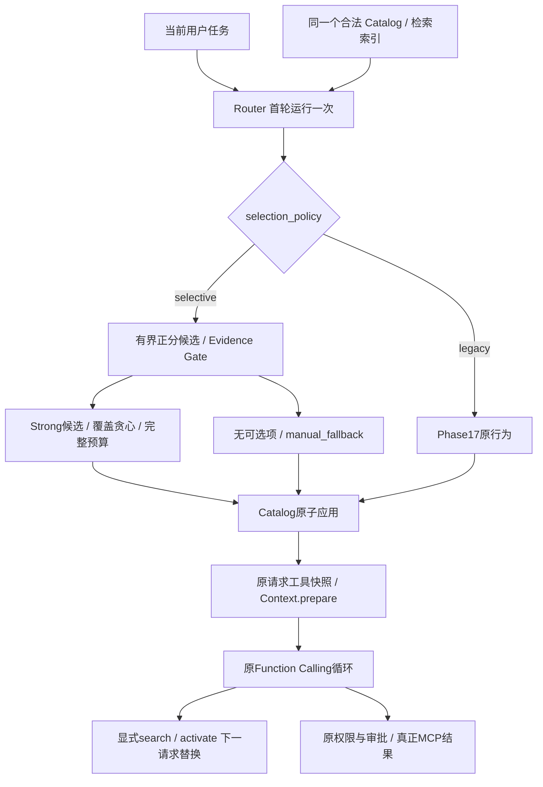

# Phase 18：Tool Routing Confidence & Safe Abstention

## 1. 学习目标与边界

理解 Ranking、相关性证据、自动预选和真正执行的区别。本阶段添加显式可选的 selective 策略：足够证据才自动暴露完整 MCP Schema，证据不足保留原 search/activate 路径。弃选不是拒绝用户请求，也不证明目录中没有合用工具。普通回答、澄清、原生文件工具和模型后续显式探索继续可用。

BM25 的正 IDF 使通用共享词也能产生正分；排序第一只说明相对于其他候选更匹配，不能证明适用。Hybrid 原始 BM25 + 0.35×别名 BM25 公式不变，没有概率校准。本章 confidence 是可解释 lexical evidence，不能读成“92%正确”。不新增 LLM 请求、Embedding、向量库、外部服务、Agent Framework 或依赖。

## 2. 配置与 Phase17 兼容

在完整配置的 mcp.discovery 对象中显式设置以下片段（服务器配置沿原模板）：

```json
{"enabled": true, "retrieval_mode": "hybrid", "routing_mode": "adaptive",
 "selection_policy": "selective", "eager_tool_threshold": 4,
 "preselect_limit": 3, "max_active_tools": 4,
 "max_active_schema_chars": 12000, "search_limit": 5}
```

selection_policy 缺省 legacy，旧配置规范化后的对象不增加默认键。非法类型、枚举和未知字段拒绝；selective 必须显式 adaptive + enabled=true，manual 不能暗开。enabled=false + legacy 保持原 Eager。两模板显式 legacy，真实 config/config.json 未动。threshold、preselect_limit、数量与 Schema 配置沿用 Phase17，默认 limit 为 min(3,max_active_tools)。没有可调“概率阈值”。

同一个 AdaptiveToolRouter 内分支，Legacy 决策顺序和排序贪心原样保留。AgentLoop、ContextManager、Registry、Planning、Session、Skills、Adapter、Manager、认证和 SDK 依赖完全未改。旧核心12例文件、Phase16检索器、词典和 Gold 未改。新 mode 使用显式 MODE_RETRIEVAL 映射，adaptive_selective_hybrid 不会被拆成非法 selective_hybrid 检索模式。

## 3. 调用流程与核心文件



- `mybot/mcp_client/relevance.py`：concepts、MatchEvidence、evidence；输入只含当前文本和已验证/限长Catalog元数据。
- `mybot/mcp_client/router.py`：route保持Legacy，_selective执行门控、小目录检查、覆盖选择；RoutingDecision兼容旧7个位置参数。
- `discovery.py`：严格校验selection_policy，原ranked_names、activate、apply_preselection保持原逻辑。
- `mybot/evaluation/tool_routing.py`：route_query运行时边界；selection_metrics独立评分，summarize报告分母；evaluate分策略/语言/类别/分割。
- `mybot/evaluation/tool_agent.py`：新增mode、独立case_set、观测与评分；固定模型只看真实请求是否暴露目标再跳过预声明探索，不替Router修复。
- 三入口evaluate_tool_routing、compare_selective_routing、evaluate_tool_agent --case-set routing；专项check_routing_confidence由check_phase纳入。

## 4. Evidence Gate 的固定 v1 规则

候选来自原ranked_names的前64个正分名称。名称只取已验证工具名的远端名称部分；Server名称及240字符内描述来自原Catalog。没有读取Schema字段来发明相关性，也不读取用户文件或执行结果。

concepts对文本沿原tokenize切词，用固定CANONICAL合并task/tasks、document/documents、event/events等复数和少量同义形式（例如data/dataset、statistics/stats）。停用词GENERIC为源码内固定小集合，包括tool/tools、available、help、synthetic、catalog、teaching、read/only及常见虚词。操作词list/get/search/query等不单独当作领域证据。Hybrid才使用原expand_query固定中英文词典；没有新增词典项。纯中文通过已有别名产生英文概念；未知中文不能伪造成已知领域。每次取前256个基础/别名token，最终查询概念按字典序上限128；长输入仍受Router4096字符限制。

DF是整个Catalog内每个查询概念在名称、Server或描述的出现文档数；合并后的独立概念避免task/tasks算两份证据。所有门限为固定模块规则：

**Strong** 满足其一：

1. 查询与名称/Server有至少一个非操作领域概念，且目录≤4、或其中至少一个概念DF≤N/2、或名称/Server命中至少两个独立概念。
2. 至少两个匹配的非操作描述概念各自DF≤N/2。

**Weak**：有有效概念但达不到上述规则，或仅共同的通用词有匹配。例如list本身不确认领域，synthetic不确认用途。

**None**：没有有效概念，也没有共同通用词。完全无正分候选直接none。仅原CJK碎片匹配不会冒充领域证据。

DF只约束区分性证据，不把所有高DF词删除。小目录里project等名称概念仍有用；高DF描述词不能仅凭第一名变成strong。Server名也可能造成误判，词法规则不理解否定、意图或真实世界能力。该证据不是概率，Gold不决定分级。

## 5. 安全弃选和 small_eager

仅Strong可进候选；Weak/None永不为了填满limit加入。无正分为no_positive_candidates；通用词匹配为generic_only_matches；其他证据不足为weak_evidence。有效Strong却装不下则schema_budget_limited或context_budget_limited，不能把预算问题称作低相关性。超长/非法输入沿原拒绝检索分支；基础请求都无法容纳仍抛原ContextBudgetError。

空初选走manual_fallback，search_mcp_tools与activate_mcp_tools、内置工具、Planning、已启用Skills仍可见。没有发出MCP调用、审批或“已完成计划”的执行证据。不能据弃选强制模型拒答。

Selective small_eager除原数量/完整Schema/Context条件，还要求全部目录工具通过Strong门控，且不超过preselect_limit；超出则转覆盖子集。部分相关转覆盖子集；闲聊、无匹配、仅通用词不会暴露全部目录。Legacy small_eager语义完全不变，仍可能在hello时暴露小目录全部工具。

## 6. Coverage-Aware Greedy Selection

对Strong候选取matched概念集合，covered初始空。每轮计算：

`utility = 新增概念数 / (1 + 完整候选Schema字符 / MCP Schema字符上限)`

单位是经相对Schema成本折算的概念数，不与BM25不同量纲任意相加。按utility降序、总匹配概念数降序、原排名、名称确定性破同分。新的匹配概念数为0则跳过；不填满preselect_limit。每次尝试完整选中集合的数量、MCP Schema真实数组字符和原ContextManager.prepare，超大候选跳过再试后续；不裁剪required、enum或description。限制达到或没有新增价值时停止。

该算法允许第二领域胜过重复工具；专项用前三个项目候选挡住文档工具的固定排名验证Legacy遗漏而Selective覆盖。它不是最优集合搜索，也不理解细粒度操作语义：共享操作词已被第一工具覆盖后，较小Schema的get_calendar_event可能胜过真正需要的list_calendar_events，再把后者判为重复。这是本轮代码模块+日程列表双工具任务退化的实际来源。small_eager全部Strong时可整体暴露，不强行去重，仍沿原小目录语义。

专用数量/Schema限制在Context关闭时仍生效；Context开启时检查包含System、消息、原生/Planning/Skills/Discovery和MCP的总请求。canonical消息、历史、Plan只供原prepare预算投影，不参与检索词，不被修改。未来业务结果增长仍可导致后续Context失败，首轮预检不能保证整个任务永不超限。

## 7. 安全、生命周期与诊断

新增selection_policy、evidence_level、abstained、abstention_reason、eligible_candidate_count、rejected_weak_count、selected_count、covered_query_concepts_count、redundant_candidates_skipped，保留原所有字段和routing_overhead_ms。diagnostics只含枚举、布尔、计数和耗时，不含原文、描述、工具名称、参数、Gold、凭证和授权地址。内部RoutingDecision选中名称仅用于原子应用，任务finally清除。

原Catalog只包含allowed_tools且非deny的Adapter，预选不授权。confirm仍走原审批，拒绝无副作用。手动activate完整替换，Router本任务不再覆盖；同批先activate再调用仍被当前请求快照拦截。原调用参数校验、Tool Call ID配对、MCP owner Task均沿用。任务结束、异常、模型超时、取消、/clear清空active/decision；Session不持久化初选。search/activate/Router均不成为Planning业务证据，只有原真实结果可验证步骤。

Gold仅在selection_metrics和原Observation/grade评分端可用。Router参数没有Case、ID、required、答案或固定动作，也不读evals目录。Spy/文件访问封锁及替换Gold测试证明同query结果不变。固定模拟器持有预声明fixture，判断当前工具可见性后走原search→activate→下一请求MCP调用；搜索miss不靠Gold添加结果。运行时不认识模拟器动作。

## 8. 数据集和指标定义

新增tool_routing_cases.json共60条：24单工具、12多工具、24负例。design/heldout各30条，各有18正例/12负例/6多工具；负例包括闲聊、无对应工具、通用词。覆盖中文、英文、混合、长查询、相近名称和不同操作。required_tools是必须精确覆盖的接口，acceptable_tools是允许相关集合；本版相同，不用模糊Gold抬高Precision。

规则先冻结为lexical-evidence-v1，再跑design和heldout；没有根据heldout失败调词典或参数。relevance.py SHA256：`50424dcbac588f8e80bfadf4451f057d264675ba437621ee749fa5c8869af7c3`；router.py：`0fd56cf4e99e1d3f659a7811ed716b5ed3e1297b8ead3af64a316fedf987dc5f`。当前选择策略版本为v1.1（证据规则仍为v1）：heldout首次运行后代码复核发现Selective small_eager也应遵守preselect_limit，补上数量契约检查并增加专项；未改证据/排名/权重，对35工具基准不影响，重跑报告验证。最终router.py SHA256为 `654215dff231bdd318b720e4fe791d0e4836956bc3db9bf8ba7e3f49ac9b5b54`。上述旧哈希是首次评测前冻结版本，不把后续修正冒充冻结前代码。这是小型人工合成分割，且沿用已有领域词典，不能声称统计意义上的跨领域泛化；heldout现已评估，未来改规则必须承认它已使用，不能反复调参仍称未见。

正例Hit是至少命中一个required；Precision=|selected∩acceptable|/|selected|，仅非空初选正例求macro平均并单列有效分母；空选Precision=null，不记1。Recall=|selected∩required|/|required|，Full Coverage=全部required均已选择。False Abstention=正例空选。负例Correct Abstention=空选，False Preselection=非空；平均无关工具数也仅负例。多工具Full Recall=全部required覆盖，Missing=缺失required数，Redundant=选中但不在required的数量（含可接受替代）。所有汇总报告cases、positive/negative/multi/precision分母；语言/类别/分割分组使用相同定义，不能把重叠组相加。

Schema字符是完整MCP数组实测，Agent累计Schema则是每次真实请求tools数组字符。耗时本地perf_counter，不是真实模型延迟。Agent预算中断不算成功，selection_quality只统计complete，已执行路由耗时/数量另由旧字段保留。新指标correct_abstention、false_preselection、irrelevant_preselected_count、multi_tool_full_coverage、coverage_gain（已覆盖概念数量，非Gold提升）、rejected_weak_candidates、recovered_by_manual_discovery均在评分侧计算或读取安全诊断。没有显式search/activate时对应成功率仍null，自动选择不冒充模型探索。

## 9. 本轮路由实测

以下均为当前同代码配对，固定Catalog35工具，不调用模型或MCP网络；路由结果与Agent任务成功率分开。

| 分割/策略 | 正/负/多/Precision分母 | Precision | Recall | Full Coverage | Hit | False Abstention | Correct Abstention | False Preselection | Multi Full Recall | Schema字符 |
| --- | --- | --- | --- | --- | --- | --- | --- | --- | --- | ---: |
| all/legacy | 36/24/12/36 | 43.52% | 98.61% | 97.22% | 100.00% | 0.00% | 62.50% | 37.50% | 91.67% | 212511 |
| all/selective | 36/24/12/36 | 88.89% | 97.22% | 94.44% | 100.00% | 0.00% | 100.00% | 0.00% | 83.33% | 87573 |
| design/legacy | 18/12/6/18 | 42.59% | 97.22% | 94.44% | 100.00% | 0.00% | 66.67% | 33.33% | 83.33% | 107079 |
| design/selective | 18/12/6/18 | 86.11% | 94.44% | 88.89% | 100.00% | 0.00% | 100.00% | 0.00% | 66.67% | 43725 |
| heldout/legacy | 18/12/6/18 | 44.44% | 100.00% | 100.00% | 100.00% | 0.00% | 58.33% | 41.67% | 100.00% | 105432 |
| heldout/selective | 18/12/6/18 | 91.67% | 100.00% | 100.00% | 100.00% | 0.00% | 100.00% | 0.00% | 100.00% | 43848 |

| 策略 | 平均初选数 | 负例平均无关工具 | 多工具平均缺失 | 多工具平均冗余 | 总路由ms |
| --- | ---: | ---: | ---: | ---: | ---: |
| legacy | 2.1833 | 0.9583 | 0.0833 | 1.0833 | 20.351 |
| selective | 0.9000 | 0.0000 | 0.1667 | 0.1667 | 27.765 |

| 分组/策略 | 正/负/多/Precision分母 | Precision | Recall | Correct Abstention | Multi Full Recall |
| --- | --- | --- | --- | --- | --- |
| en/legacy | 25/18/8/25 | 44.00% | 100.00% | 55.56% | 100.00% |
| en/selective | 25/18/8/25 | 94.00% | 98.00% | 100.00% | 87.50% |
| mixed/legacy | 3/1/1/3 | 44.44% | 100.00% | 100.00% | 100.00% |
| mixed/selective | 3/1/1/3 | 83.33% | 100.00% | 100.00% | 100.00% |
| zh/legacy | 8/5/3/8 | 41.67% | 93.75% | 80.00% | 66.67% |
| zh/selective | 8/5/3/8 | 75.00% | 93.75% | 100.00% | 66.67% |
| chat/legacy | 0/6/0/0 | — | — | 83.33% | — |
| chat/selective | 0/6/0/0 | — | — | 100.00% | — |
| generic/legacy | 0/9/0/0 | — | — | 44.44% | — |
| generic/selective | 0/9/0/0 | — | — | 100.00% | — |
| multi_tool/legacy | 12/0/12/12 | 63.89% | 95.83% | — | 91.67% |
| multi_tool/selective | 12/0/12/12 | 91.67% | 91.67% | — | 83.33% |
| no_match/legacy | 0/9/0/0 | — | — | 66.67% | — |
| no_match/selective | 0/9/0/0 | — | — | 100.00% | — |
| single_tool/legacy | 24/0/0/24 | 33.33% | 100.00% | — | — |
| single_tool/selective | 24/0/0/24 | 87.50% | 100.00% | — | — |

Selective减少无关暴露，但总Recall和多工具覆盖均下降，不能宣称全面优胜。design的route-multi-03/04（代码模块+日程列表，中英文）各遗漏list_calendar_events、误选get_calendar_event，已如实保留；heldout此轮没有遗漏，不代表以后不会漏。所有规则未因这些结果调整。

## 10. 真实本地MCP端到端比较

核心12条原文件不动；独立tool_agent_routing_cases.json有10条挑战任务，包括量子无匹配、闲聊、出现tool但不应调用MCP、真实builtin写文件、相近项目工具和四个双领域任务。Limits默认max_cases=12、上限15不改；独立case_set可跑完整10条，不替换核心集。每mode/case新Agent、Session、临时空Workspace，相同35工具合成stdio、权限、配置、Context和最终评分。builtin挑战通过实际write_file ToolResult验证；只给正确最终文字不能绕过业务要求。Phase9 runner评分完全未改；Harness仅把builtin执行要求与MCP审计数分别计数，旧核心评分含义不变。

### 核心12条

| 模式 | 成功/样本 | 请求 | 累计Schema字符 | MCP调用 | Search/Activate | 模型探索段 | Correct Abstention | False Preselection | 正例Recall | 多工具完整覆盖 | 手动补救成功 |
| --- | --- | ---: | ---: | ---: | --- | ---: | --- | --- | --- | --- | ---: |
| eager | 12/12 | 25 | 1461425 | 13 | 0/0 | 0 | — | — | — | — | 0 |
| progressive_hybrid | 12/12 | 51 | 175363 | 13 | 13/13 | 13 | — | — | — | — | 0 |
| adaptive_hybrid | 12/12 | 25 | 176425 | 13 | 0/0 | 0 | 50.00% | 50.00% | 100.00% | 100.00% | 0 |
| adaptive_selective_hybrid | 12/12 | 27 | 137582 | 13 | 1/1 | 1 | 100.00% | 0.00% | 95.00% | 66.67% | 1 |

路由分母：adaptive_hybrid 正/负/多/Precision=10/2/3/10，Precision=43.33%；adaptive_selective_hybrid 正/负/多/Precision=10/2/3/10，Precision=76.67%；

### 独立挑战10条

| 模式 | 成功/样本 | 请求 | 累计Schema字符 | MCP调用 | Search/Activate | 模型探索段 | Correct Abstention | False Preselection | 正例Recall | 多工具完整覆盖 | 手动补救成功 |
| --- | --- | ---: | ---: | ---: | --- | ---: | --- | --- | --- | --- | ---: |
| eager | 10/10 | 21 | 1227597 | 10 | 0/0 | 0 | — | — | — | — | 0 |
| progressive_hybrid | 10/10 | 41 | 142075 | 10 | 10/10 | 10 | — | — | — | — | 0 |
| adaptive_hybrid | 10/10 | 23 | 158372 | 10 | 1/1 | 1 | 25.00% | 75.00% | 91.67% | 75.00% | 1 |
| adaptive_selective_hybrid | 10/10 | 23 | 109693 | 10 | 1/1 | 1 | 75.00% | 25.00% | 91.67% | 75.00% | 1 |

路由分母：adaptive_hybrid 正/负/多/Precision=6/4/4/6，Precision=50.00%；adaptive_selective_hybrid 正/负/多/Precision=6/4/4/6，Precision=91.67%；

核心Selective仍12/12成功，但初选漏掉一项双工具目标，固定模型通过真实手动探索补救，增加2次请求。挑战Selective仍有一次误预选：challenge-10只需builtin写文件，file概念误触发MCP代码文件工具；正确弃选只有3/4，不能用纯路由60例负例零误选隐藏此失败。challenge-9解释tool正确弃选，但不能据此证明规则理解否定。挑战两Adaptive各有一次初选遗漏、最终靠手动探索成功。固定模型按fixture执行，不是自主选择能力，不将业务最终成功掩盖为预选全召回。

离线报告actual_tokens=null、actual_cost=null、live_task_success_rate=null；每请求usage/cache缺失也保持null，字符不能替代Token或费用。不运行真实API、不连接第三方MCP/OAuth。耗时随本机调度变化，仅行为/分母/字符应复现。默认不保存运行报告；本轮JSON在系统临时目录，未提交。未来Live仍需原双开关，SDK retry=0与共享预算不变；本阶段未运行Live。

## 11. macOS + uv 操作与常见问题

```bash
uv sync --frozen
uv run python mybot/main.py
uv run python -m scripts.check_routing_confidence
uv run python -m scripts.evaluate_tool_routing --split design
uv run python -m scripts.evaluate_tool_routing --split heldout
uv run python -m scripts.compare_selective_routing
uv run python -m scripts.evaluate_tool_agent --case-set routing --modes adaptive_hybrid,adaptive_selective_hybrid
uv run python -m scripts.compare_tool_retrieval
uv run python -m scripts.compare_adaptive_routing
uv run python -m scripts.evaluate_tool_agent
uv run python -m scripts.check_phase
uv run python -m compileall -q mybot scripts
uv run python -m scripts.test_phase_archives
```

- 开启selective报配置错误：检查enabled与routing_mode，别只改selection_policy。
- 没有自动工具：查看evidence_level、abstention_reason，可能是词法证据不足、输入限制或真实预算，不代表执行权限失败。
- 正例Recall下降但任务成功：检查recovered_by_manual_discovery和search/activate请求，不要只读task_success。
- 多个相似工具未选满：覆盖没有新增价值时会停止；也可能把不同业务工具错判重复。
- 中文漏选：仅支持既有固定别名；不会自动翻译或联网，不为某条Gold加词。
- ExFAT编译遇到._*.py：仅检查文件头为AppleDouble后清理相应元数据；不删除用户源码，归档用git archive排除元数据。COPYFILE_DISABLE=1减少生成，不能保证系统完全不生成。

## 12. 验证、归档与后续边界

专项包含严格配置、Strong/Weak/None、中英文别名、未知词、高DF、小目录全相关/部分/闲聊/无匹配、冗余与跨领域、数量/Schema/Context、原子性、Gold隔离和无I/O、首次可见性、手动替换、同批快照、deny/confirm、Planning证据、Session与clear、异常/超时/取消、真实MCP owner生命周期、真实builtin、指标分母、不完整样本和Live控制；原全阶段回归共同验证旧接口。

最终新增38项专项全部通过；Phase1–18全量422项unittest及Phase1/2原断言通过。原17 Retrieval/39 Discovery/24 Harness/30 Adaptive专项均保留通过。旧检索报告与独立还原的Phase17逐项一致；旧默认Agent及Phase17三模式、新四模式当前版本配对比较均重跑，除本地计时/Git元数据外结果复现。mybot/scripts编译和归档安全集成测试通过；ExFAT仅清理文件头确认的AppleDouble。提交前审阅全部已跟踪/新增路径及内容，未包含真实配置、凭证、Session、报告或不必要大文件。干净APFS worktree归档时独立冻结安装、编译mybot、422项及原断言通过；发布ZIP另在APFS解压，冻结安装、编译mybot/scripts、38项专项及新四模式比较通过。restore_phase.sh还原的独立学习目录再次冻结安装、编译mybot/scripts、422项及原断言通过；旧排名、默认Agent、Phase17三模式与本阶段新比较的所有非耗时/Git字段逐项一致。还原清理91个文件头确认的AppleDouble。CRC、完整128文件清单、ZIP提交SHA、原用户文件已提交版本一致，无元数据。旧17个Tag对象/ZIP哈希和用户两文件内容保持不变。最终记录另作文档提交，不移动Tag。

仍启动并发现所有配置Server，只改变首轮Schema可见性，没有减少Server启动或Schema缓存成本。当前证据名称解析使用双下划线最后片段：合法远端名含`__`时，前缀概念会丢失，可能漏选；源码与单独构造目录验证此限制，原排名/显式搜索仍能找到工具。复杂标识符归一化是后续修正方向。

后续方向：更好的动作概念、否定和细粒度任务覆盖，必须使用新的独立数据验证；不在本阶段引入Embedding或自动改代码。Phase18只是可复现候选策略评估基础，不实现RSI自修改闭环。未来晋级还需独立测试、负面回归、明确条件、受控批准和回滚。本阶段停止于18，不进入19，不Push，不改旧Tag或ZIP，保留用户app.py与USER.md修改。

## 13. 新增和修改文件清单

新增8个文件：mybot/mcp_client/relevance.py、mybot/evaluation/tool_routing.py、evals/tool_routing_cases.json、evals/tool_agent_routing_cases.json、scripts/check_routing_confidence.py、scripts/evaluate_tool_routing.py、scripts/compare_selective_routing.py、docs/phases/phase-18.md。

修改10个文件：mybot/mcp_client/router.py、mybot/mcp_client/discovery.py、mybot/evaluation/tool_agent.py、scripts/check_phase.py、scripts/evaluate_tool_agent.py、config/config.example.json、config/mcp.discovery.example.json、README.md、docs/phases/README.md、AI_HANDOFF.md。mybot/app.py与workspace/instructions/USER.md的用户修改未加入本阶段提交。

## 14. 独立归档与还原记录

唯一annotated `phase-18` 指向实现提交 `d1808304202d0d1c5d9bdfb7f4d68f6bdaff00a9`。ZIP：`../mybot-mini-snapshots/phase-18.zip`，147条目/128文件，SHA256：`fed645e2b0175ff7eecfa9fa2a266780885d5926e5e7828103c18ed65f932819`。还原目录：`../mybot-mini-learning/phase-18`。这些均为本地结果，未Push。当前主分支另含最终验证记录提交；Tag保持实现提交，不为文档记录移动Tag。

生成方式（现存Tag/ZIP不可覆盖，以下save命令仅说明原归档过程）：

```bash
# 本轮在干净APFS worktree执行，导出后独占复制至主项目同级快照目录
bash scripts/save_phase.sh 18 "Tool Routing Confidence & Safe Abstention"
# 目标目录不存在时才执行；已还原时直接cd进入
bash scripts/restore_phase.sh 18
cd ../mybot-mini-learning/phase-18
uv sync --frozen
uv run python -m compileall -q mybot scripts
uv run python -m scripts.check_phase
uv run python -m scripts.compare_tool_retrieval
uv run python -m scripts.evaluate_tool_agent
uv run python -m scripts.compare_adaptive_routing
uv run python -m scripts.compare_selective_routing
```

archive-ready: true
