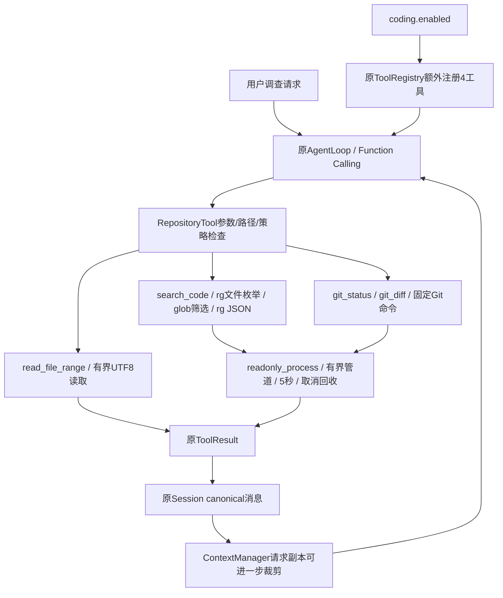

# Phase 19：Repository Exploration & Code Search

archive-revision: r1

**修订版r1：原phase-19 Tag/ZIP存在Git过滤器名边界漏洞，不作为最终安全交付；原样保留，不覆盖。当前推荐phase-19-r1，代码及专项/全量/归档脚本验证通过，待独立修订归档与还原。**

## 1. 学习目标与方向变化

项目为mybot-mini，环境macOS、Python3.12+、uv。从Phase18的MCP路由质量研究转向本地Coding Agent的仓库调查能力；本阶段不再调整路由策略、词典或评分。Coding Agent需要把“函数在哪里”“谁调用它”“哪些修改已经属于用户”转化为可核对的路径、行号、状态与Diff，再进入后续编辑/测试阶段。本阶段只有阅读能力，没有新增Patch、Shell、测试执行、自动修复、Commit或回滚工具。

四个原生工具：search_code、read_file_range、git_status、git_diff。它们通过原Tool/ToolResult/ToolRegistry进入原Function Calling循环，不通过MCP模拟，不建立第二个Registry、ContextManager或ReAct循环。真实源码与Git输出是证据，固定模拟器只验证工具链，不能证明真实模型理解代码的能力。

## 2. 默认兼容与配置

完整配置中的可选片段：

```json
{"coding": {"enabled": false}}
```

coding.enabled缺省false，严格拒绝非布尔值、非对象coding和对象内未知字段；模板为false，真实config/config.json不改。GatewayConfig.coding_enabled来自此配置；build_default_tool_registry(workspace, *, coding_enabled=False)的旧调用仍只注册read_file/write_file/list_files，默认旧Schema字节结构不变。

只有显式true才额外注册四个工具，Gateway显式传递配置。Coding模式要求目标Workspace已经存在，并跳过原init_workspace引导写入，避免给待调查的真实仓库自动增加instructions文件；原false模式仍沿用旧初始化流程。启用Coding不改变MCP开关、不自动启用API、不提供额外模型请求。

用户应显式将workspace.path设置为待调查项目根目录。默认workspace目录不是mybot-mini源码目录；如果Git根在Workspace父目录，工具拒绝使用父仓库，不自动扩大权限。

本阶段开发位于独立worktree的codex/phase-19分支，基线3461dc7。原工作区main及用户app.py、USER.md未提交修改保持不变；没有把用户注释或偏好文件混入提交，没有自动合并回原目录。

## 3. 工具调用链与核心文件



- `repository.py`：RepositoryTool复用FileTool._resolve；resolve、read_text、git_root、git；统一参数/策略/5秒操作期限/错误脱敏。
- `readonly_process.py`：executable选择可信宿主Git/rg；run_readonly创建固定argv进程、并行有界读取stdout/stderr、资源限制、超时/取消清理；ProcessResult安全状态。
- `search_code.py`：SearchCodeTool._execute，两阶段rg、稳定JSON结果和实际列号。
- `read_file_range.py`：ReadFileRangeTool._execute，UTF-8严格解码、LF行号、闭区间、续读元数据。
- `git_tools.py`：GitStatusTool._execute解析NUL，GitDiffTool._execute区分Index/HEAD并输出有界Unified Diff。
- `registry.py/config.py/app.py`：默认关闭的注册与真实Gateway接线。
- `agent/loop.py`：只增加两行Coding私有参数日志遮蔽，循环、执行权限、配对、Session和Plan算法未改。
- `coding_repo_demo.py/check_repository_tools.py/check_phase.py`：合成仓库、真实工具链与全量回归接入。

## 4. Workspace与统一读取策略

四个工具继承同一FileTool。路径先在Workspace中解释，Path.resolve+is_relative_to拒绝绝对/相对逃逸和外部符号链接；同时检查原路径拼写与解析后的目的地，内部别名不能绕过敏感路径策略。内部符号链接的显式请求可解析到内部真实文件，结果使用真实相对路径；递归rg不跟随链接。

新工具内容读取统一拒绝所有隐藏路径部分，以及node_modules、venv、__pycache__、dist/build、cache/caches、sessions、secrets、runs目录；拒绝常见密钥/数据库/权重/归档/缓存后缀、credentials及id_rsa/id_ed25519、config/config.json。大小保护为2MiB。git_status只返回状态与文件名，仍可显示敏感文件名，帮助用户识别需保护的修改；git_diff排除这些文件的正文并明确计数。

read_file_range使用O_NOFOLLOW/O_NONBLOCK打开解析后的普通文件，再用fstat验证类型，最多读2MiB+1字节，拒绝NUL与无效UTF-8。不是用replacement character修补源码。目录、设备、FIFO等不作为代码文件读取。

这不是恶意并发文件系统的完整OS沙盒：父目录可在检查与打开之间被替换，硬链接关系也不能据路径识别。合法worktree的Git元数据可以在Workspace之外；工具信任用户选择的本地Git元数据，仍检查实际toplevel。本阶段面向可信本地仓库，不承诺沙盒敌对仓库或宿主可执行程序。

原read_file/write_file/list_files完全未重构，仍沿旧规则；新工具的保守私有路径限制不代表整个Agent有完整秘密隔离能力。

## 5. search_code：Ranking之外的真实代码位置

参数：query必填，1–256字符且非空白；path缺省`.`，mode为literal/regex，case_sensitive缺省true，file_glob可选，max_results为1–50，缺省50。未知参数与错误类型拒绝。路径必须存在且属于Workspace；Unicode、空格与特殊文件名使用argv传递，绝不拼Shell。

Literal按原字面串检索；Regex使用rg默认Rust引擎，显式--engine=default，不启用PCRE2。正则能表达函数名形态、行首等结构，但不提供语义代码索引；例如`^def (add|total)\(`。非法表达式明确search_failed，不静默切换引擎。

第一步以--no-config --files --null --sort=path --no-follow --no-require-git枚举允许文件；固定排除规则为最后的大小写不敏感negative glob。第二步在尊重.gitignore的候选中用Python fnmatch筛选file_glob（匹配相对路径或basename），显式文件目标也必须通过枚举。这样避免rg正向glob重新包含被.gitignore忽略的文件。全列表最多2048文件、128KiB原始输出，超出明确truncated，建议缩小path。即使非Git文件夹，.gitignore也生效。

第二步用--no-config --engine=default --json --line-number --column --sort=path --color=never --no-follow --max-filesize=2M，加--fixed-strings或大小写选项，最后以--分隔模式与经过校验的`./相对文件名`。`-`不会变成stdin，`--no-ignore`或`$(...)`查询也只是数据。无模型控制的可执行程序、环境、cwd或任意选项。

stdout读取时就限制128KiB和最多max_results+1个match事件（多读一个用于判断截断），不会先无界communicate再裁剪。稳定顺序为路径与原行号。匹配文件还在2MiB限制内严格验证UTF-8与NUL，避免把二进制或损坏文本当源码。每条文本最多500字符，JSON结果约14000字符，加元数据后不超过约16000字符；单条文本缩短也令整体truncated=true。

结果：

```json
{"matches":[{"path":"src/calculator.py","line":1,"column":1,
 "text":"def add(left, right):\n","text_truncated":false}]}
```

column为rg的1-based UTF-8字节列，不是Unicode字符或显示宽度。metadata含shown/truncated/max_results/search_mode/timed_out；被策略或编码剔除的匹配另有计数。无匹配success=true并返回空matches与No matches。rg退出1是无匹配，2等真实错误失败；资源终止的负退出码只可返回明确截断的前缀。缺依赖返回dependency_missing，绝不伪造搜索结果。

## 6. read_file_range：稳定闭区间与续读

旧read_file只读取前50000字符，新工具支持path/start_line/end_line必填，行号均为正整数，end>=start，每次至多200行。LF定义真实行号，CRLF原样保留，不把Unicode行分隔符误算成rg的换行。文件内容不修改、不执行。

输出如`70 | ...`；仅在2MiB内计算完整行数。输出正文预算14500字符，整个ToolResult约16000以内。metadata包括requested_start_line、returned_start_line/end_line、total_lines、truncated、next_start_line、partial_line。

读完一个完整区间且后面还有内容时，next_start_line为下一行；空文件明确empty file、返回行号null。非空文件起始行越过EOF明确start_line_out_of_range；end越过EOF可返回实际存在部分，结合total_lines判断。

若输出预算在行中耗尽，明确partial_line，next_start_line仍为该行，不能跳过未展示后缀而声称读完。第一版没有字符偏移参数，超长单行后缀可能无法通过本工具完整展示，这是有意记录的限制；普通多行可缩小区间继续读取。源码与原换行字节保持不变。

## 7. Git Working Tree、Index与HEAD

Working Tree是磁盘文件；Index是已暂存内容；HEAD是当前提交。

- git_status的XY两列：X对应Index相对HEAD，Y对应Working Tree相对Index。同一文件可同时staged=true、unstaged=true。
- git_diff scope=unstaged：Working Tree与Index比较。
- git_diff scope=staged：Index与HEAD比较。
- Untracked尚未进入Index，普通git diff不包含正文。必须结合status和read_file_range，不能伪造未跟踪Diff。

Git状态可以指出用户已有修改，需要后续编辑特别保护；读取成功不说明Bug已修复或测试通过。

## 8. git_status：NUL解析与仓库边界

repo_path缺省`.`，允许Workspace下的嵌套仓库。先在Workspace范围内寻找.git，不越过Workspace向父目录找仓库，再用固定rev-parse --show-toplevel验证实际根；普通非Git返回not_git_repository，声明外部worktree根则repository_outside_workspace。合法Git worktree可使用外部common Git目录，仍要求checkout根在Workspace内。不自动初始化。

实际状态命令使用status --porcelain=v1 -z --untracked-files=normal --ignore-submodules=all --renames。按NUL解析记录，保留XY原始列；R/C额外消耗一个NUL路径，首路径为新路径、第二个为旧路径。不能用splitlines，文件名本身可含换行、引号、中文与空格。

结构化files包含path、index_status、worktree_status、staged、unstaged、untracked、status，重命名有previous_path。最多200条、约45000字符JSON；原始流也有128KiB/记录数限制。clean只有在无条目且无截断时才为true，未知完整状态不能冒充clean。不递归检查子模块。

## 9. git_diff：标准语义与有限内容

参数repo_path、scope（缺省unstaged，仅staged/unstaged）、file_path可选。file_path相对Git根，绝对路径仍须同时在Workspace与该仓库内；仅支持文件，不提供目录过滤。已删除文件允许用于Diff。GIT_LITERAL_PATHSPECS=1和--分隔保证`:(glob)**`、星号或前导短横线都是文件名，不是扩大范围的pathspec magic。

命令以--no-pager和固定diff --no-ext-diff --no-textconv --no-color --no-renames --ignore-submodules=all --unified=3执行，staged时固定加--cached。不提供模型自定义Git选项或revision。禁用重命名相似度检测时，重命名Diff表现为标准删除/新增；status仍识别重命名。

省略file_path时，先对当前scope有界获取--name-only -z的修改路径，再过滤私有/越界/超大文件，随后读取允许文件的Diff。不是把全部源码Diff读进来再删除秘密。默认最多约200条路径；原始文件列表与正文都有字节/记录上限。正文最多300行/23000字符，加元数据约24000以内。超限明确truncated，策略排除另报excluded_private_or_large_files；没有完整前缀时也不把空输出当作空Diff证明。

保持Git标准Unified Diff及文件名转义，不自行拼造补丁，不调用外部diff、textconv、Pager，不stage/restore/checkout/reset/commit。未跟踪文件不包含正文，返回说明和untracked_content_included=false。

## 10. 为什么“只读Git”还要防执行与远程访问

仅禁用shell=True远远不够。Git本身可按配置启动Pager、fsmonitor、外部diff、textconv、clean/smudge/process过滤器，部分克隆缺失对象还可能惰性取回并启动远程helper。

内部runner仅允许程序git/rg，在系统、Homebrew或宿主.app/Contents目录中定位真实可执行文件，拒绝Workspace中的同名程序/链接目标、相对PATH项与任意模型executable。宿主安装位置本身需要信任；不是验证二进制签名的完整供应链沙盒。

每次子进程使用新建最小环境，不继承GIT_DIR/WORK_TREE/INDEX_FILE/CONFIG_COUNT、外部diff、Pager、RIPGREP_CONFIG_PATH、动态加载器注入等环境。固定GIT_CONFIG_NOSYSTEM/GLOBAL=/dev/null、GIT_OPTIONAL_LOCKS=0、GIT_TERMINAL_PROMPT=0、GIT_NO_LAZY_FETCH=1、GIT_NO_REPLACE_OBJECTS=1、GIT_ATTR_NOSYSTEM=1。

Git argv固定关闭core.fsmonitor、hooksPath、Pager、用户attributes/excludes文件、untrackedCache、preloadIndex，忽略子模块。status/diff前用有界只读git config枚举filter键，以同名-c覆盖clean/smudge/process为空、required=false；由于-c按第一个等号分隔，r1先严格限制filter键为无歧义ASCII名称（字母/数字/点/下划线/短横线），含等号、空格、引号等名称即unsafe_git_filter_configuration，不执行status/diff。配置过多/损坏也失败，不带着未屏蔽的过滤器继续。测试实际放置会写marker的脚本，确认这些入口以及缺失promisor blob的远程helper均未执行。

允许的Git元数据/属性仍是可信本地仓库数据，Git内部可能读取对象和属性；参数与输出限制不是OS级资源隔离或所有Git版本的安全认证。本机实际Git2.54.0 (Apple Git-157)、rg15.2.0，独立还原再次执行真实专项；旧系统版本必须先验证支持这些选项/环境，不能仅凭uv安装宣称成功。

## 11. 有界子进程、超时与取消

readonly_process.run_readonly只能由内部固定Git/rg调用，未注册run_command。使用create_subprocess_exec(argv)，DEVNULL stdin，专用新session，stdout/stderr同时分块读取，每块4096字节、保留量有界。默认stdout128KiB，stderr4KiB；Diff正文读取100000字节/302记录后终止。跨整个工具操作的asyncio.timeout为5秒，包括仓库验证、配置枚举和查询；单进程也有5秒限制。

资源触顶、超时或取消时，只清理本次新session对应的进程组并wait/drain回收；组信号被宿主拒绝时退回直接终止自己的子进程。每个进程只触发一次终止，不按名称杀系统进程。取消继续传播CancelledError，超时返回timed_out/truncated。测试验证真实PID回收、stdout/stderr上限、fallback及无关进程存活。

这些是固定可信Git/rg的控制措施，不承诺沙盒任意会自行脱组的恶意后代、网络文件系统阻塞或外部原生程序的峰值内存。工具不允许模型启动这种任意程序；开发/测试中的git init/add/commit仅用于合成夹具准备，不能由Agent调用。

## 12. Agent、Planning、Context、Session与隐私

四个工具是原生Coding Tools，不是MCP Adapter；即使Adaptive弃选MCP也持续可见，不经MCP Catalog/activate/allowlist/OAuth。coding.enabled只是注册开关，现有MCP Approval不覆盖它们，不能声称已获得Phase11审批保护。Skills可指导查询，不能扩大Workspace。

AgentLoop继续逐次Function Calling，工具结果按原Tool Call ID配对。调查步骤可由真实搜索/读取/状态/Diff成功推进原Plan，但原Plan只是通用执行证据，不能把调查完成等同于代码修复或测试通过；没有修改其算法。

工具结果先自身有界，再由原ContextManager对请求副本裁剪，保留明确节选提示，Schema required不裁剪；canonical Session保存原有界结果不被覆盖。大返回测试验证模型请求含裁剪标记、canonical仍保留原文、/clear不变，基础预算不足保持ContextBudgetError。

**源码、搜索结果、Diff可能发送给配置的LLM Provider，并进入Session；开启持久化时可写入磁盘。没有完整秘密脱敏承诺。**默认日志不打印查询、参数路径或正文；四工具private_arguments在原debug分支统一遮蔽，仅保留名称、成功、输出字符数等安全计数。原工具和MCP日志语义保持原样。源码是Tool角色数据，不提升为System指令；没有新增秘密识别器或Prompt Injection沙盒。

## 13. 完全合成的教学仓库

scripts.coding_repo_demo.make_demo创建：pyproject.toml、src/calculator.py、tests/test_calculator.py、README.md和.gitignore。空目录保护避免覆盖现有项目。夹具准备固定git init/add/commit，使用合成作者、禁用签名/Hook和宿主配置；之后制造README已暂存、calculator未暂存、notes.txt未跟踪三类状态。

教学函数：

```python
def add(left, right):
    """Add two numbers (contains a teaching bug)."""
    return left - right

def total(values):
    return add(values[0], values[1])
```

tests/test_calculator.py含add(2,3)==5断言，但Demo Agent不运行它，也不修改减法Bug。搜索`def add`定位定义，搜索`add(`可定位total和测试中的调用文本；这只是字面引用，不是AST符号解析。

实际离线运行：

```bash
uv run python -m scripts.coding_repo_demo
```

真实流程：git_status → search_code → 根据实际命中path/line调用read_file_range → git_diff → 最终回复。固定模型从真实ToolResult解析路径/行号，并核对实际状态、源码与Diff，不能直接伪造搜索结果。

本轮结果：5次模型协议请求（固定模拟器，未发API），实际定位`src/calculator.py:1 add`，读取到`return left - right`，状态确认该文件未暂存修改，Diff显示真实调查注释。files_unchanged=true、index_unchanged=true、tool_call_ids_paired=true；actual_tokens与actual_cost=null。最终仅报告定位与修改状态，没有宣称修复或测试通过。

可显式生成供复习的空目录仓库：

```bash
uv run python -m scripts.coding_repo_demo --create /tmp/mybot-calculator-study
```

这是夹具生成入口，会写入该新目录并初始化Git；它不是Agent Tool。存在非空目录会拒绝。不要把该参数指向用户实际项目。

## 14. macOS + uv 安装与运行

```bash
# 系统依赖，不由uv.lock安装
brew install ripgrep
rg --version
git --version
uv sync --frozen

# 默认全离线
uv run python -m scripts.check_repository_tools
uv run python -m scripts.coding_repo_demo
uv run python -m scripts.check_phase
uv run python -m scripts.compare_tool_discovery
uv run python -m scripts.compare_tool_retrieval
uv run python -m scripts.compare_adaptive_routing
uv run python -m scripts.compare_selective_routing
uv run python -m scripts.test_phase_archives
uv run python -m compileall -q mybot scripts

# 实际CLI，需用户自行配置Provider与现有Workspace；本阶段未运行真实API
uv run python mybot/main.py
```

config/config.example.json复制到真实配置后，只在本地填凭证、coding.enabled=true与workspace.path。配置和Session不提交。缺rg或git返回dependency_missing，独立还原须真实验证依赖，不能用mock替代集成成功。

## 15. 专项、旧基准与全量验证

新增34项unittest将70项建议行为合并为配置/注册、真实literal/regex/case/glob/行列、Unicode/特殊文件名、忽略/私有路径/二进制/编码、排序/无匹配/上限、真实超时/取消回收、恶意PATH/配置/选项注入、按行续读/长行/CRLF/大小、Git各状态/重命名NUL/嵌套/外部根/worktree、scope/pathspec/Diff截断、Index/文件不变、helper/filter/pager/textconv不执行、缺失对象不惰性取回、Gateway接线与不引导写入、原AgentLoop/Context/Session/Plan/Discovery兼容等断言。

四份旧基准与独立还原Phase18当前同代码重跑逐字段对比，除计时/Git元数据全部一致；Coding关闭时没有四个新Schema。Phase18核心四模式仍12/12成功，Eager25请求/1461425字符、Progressive51/175363、Legacy25/176425、Selective27/137582；挑战集四模式仍10/10。这里用实际比较证明兼容，没有用历史数值代替本轮运行。

初版全量455项及Phase1/2原断言通过，但新增的过滤器名复核暴露安全漏洞，原测试不足以覆盖。r1的34项专项与456项全量（旧422+新34）及原断言通过，增加歧义过滤器名的双工具回归和修订归档兼容/禁止覆盖检查。归档安全集成通过，mybot/scripts编译通过。提交前审阅全部136个已跟踪/新增文件路径及内容，凭证/Session/真实配置/缓存/运行报告/大型文件检查无异常；原main与两处用户修改、旧18组Tag/ZIP哈希保持不变。独立归档及还原在提交后执行，最终结果另作文档记录。

## 16. 限制与后续边界

这是文本搜索，不是语言服务器/AST索引；动态调用、别名、跨语言语义可能漏查。默认排除隐藏/依赖/私有文件；显式range不解析.gitignore，但仍执行相同私有路径策略。2048文件、2MiB文件和所有输出/时间预算会影响召回，必须根据truncated缩小范围。长单行没有字符偏移续读；只支持UTF-8；非UTF-8路径/正文不会替换字节冒充原文。status不检查子模块，Diff禁用重命名检测，秘密探测不完整。

依赖宿主可信Git/rg，路径检查不是OS沙盒，固定模拟器不是自主代码理解评测。没有Patch、命令执行、测试运行、自动修复或自动Git写工具；原write_file仍保留，不意味着整个Agent只读。开发阶段固定Git准备/提交不属于模型工具能力。

Phase19完成后停止，等待用户下一项任务，不进入Phase20，不Push。原工作区用户修改继续保留，独立分支成果可在worktree检查和运行；不自动合并覆盖用户app.py。

## 17. 文件清单与归档流程

新增8个文件：mybot/tools/repository.py、readonly_process.py、search_code.py、read_file_range.py、git_tools.py；scripts/coding_repo_demo.py、scripts/check_repository_tools.py、docs/phases/phase-19.md。

修改13个文件：mybot/tools/registry.py、mybot/config.py、mybot/app.py、mybot/agent/loop.py、config/config.example.json、scripts/check_phase.py、README.md、docs/phases/README.md、AI_HANDOFF.md，以及scripts/phase_common.sh、scripts/save_phase.sh、scripts/restore_phase.sh、scripts/test_phase_archives.py（r1不可覆盖修订归档支持）。app.py修改基于干净已提交版本，用户原文件未覆盖；USER.md不在阶段修改中。

本阶段从干净已提交worktree保存，唯一Tag/ZIP不可移动覆盖：

```bash
bash scripts/save_phase.sh 19 "Repository Exploration & Code Search" r1
# 工作树版脚本输出到其同级目录，随后独占复制至原项目同级mybot-mini-snapshots
bash scripts/restore_phase.sh 19 r1
cd ../mybot-mini-learning/phase-19-r1
uv sync --frozen
rg --version
git --version
uv run python -m compileall -q mybot scripts
uv run python -m scripts.check_phase
uv run python -m scripts.coding_repo_demo
```

已存在还原目录时不覆盖，直接进入已有学习目录。ExFAT可能自动生成._*；复制设置COPYFILE_DISABLE=1减少元数据，仅对已确认AppleDouble头的文件清理，ZIP不包含它们。独立验证优先APFS。不自动Push，不合并原main，不进入20。


## 18. r1修订原因与不可覆盖的历史

初版过滤器屏蔽直接把Git config返回的键放进`-c key=`。Git按第一个等号分割，因此合法过滤器名`foo=bar`会使覆盖错位。归档后额外的合成目录复核确认脚本marker被执行；初版33/455项不足以覆盖此情况。当前实现先校验所有可执行过滤器键为无歧义ASCII标识符（字母、数字、点、短横线、下划线），其他名称在任何status/diff前失败关闭；新增34号专项在两个工具中确认拒绝并且marker不出现。不能把初版旧测试通过当作安全证明。

已存在phase-19与phase-19.zip按AGENTS不可移动/覆盖规则原样保留，推荐使用新annotated phase-19-r1与phase-19-r1.zip。两者是同一个学习阶段的修订，不进入Phase20。只接受数字的旧归档脚本增加可选rN后缀，基础文档仍phase-19.md；restore可从`archive-revision: r1`选择修订版，或显式传r1。没有revision的历史Phase保持原行为，目标目录和Tag/ZIP仍禁止覆盖。

请从本阶段worktree使用新脚本；原main仍为Phase18，其旧restore脚本不理解修订后缀。原phase-19学习目录也保留，不应作为修复版本运行；新目录为phase-19-r1。

archive-ready: true
