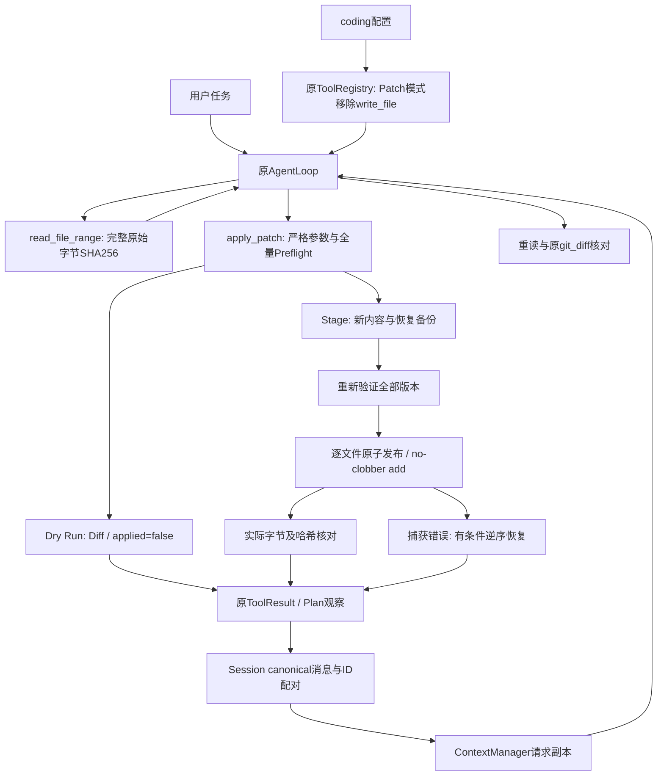

# Phase 20：Patch-Based Editing — 安全精确代码修改

## 1. 学习目标与基线

本阶段让原 AgentLoop 在真实临时 Git 仓库中完成读取、版本校验、预览、精确修改、重读和 Diff 核对。以 `codex/phase-19` 的 `4343ada` 为基线（包含 `6c27477` 安全修订），在独立 APFS worktree 的 `codex/phase-20` 开发。旧 `phase-19` 初版存在歧义 Git 过滤器键漏洞，不能用它替代 r1 基线。原 main 工作区和用户未提交文件不参与开发。

Coding Agent 的工具分为调查、编辑、执行三种能力。Phase19提供调查，本阶段提供受约束编辑；没有新增 Shell、测试运行、Git 写操作或自我修改机制。固定模拟模型验证调用链和真实文件结果，不证明真实 LLM 的自主修复能力。完成后停止，不进入 Phase21。

## 2. 全文件覆盖与结构化 Patch

旧 write_file 直接覆盖整个文件，模型遗漏的注释或换行可能丢失。新 apply_patch 让模型描述明确的旧片段和新片段；文件其他字节由宿主保留。第一版不解析 GNU Unified Diff，也不把文本交给外部 git apply。Unified Diff 是工具生成的展示结果，不是输入语言。

实际输入结构：

```json
{
  "dry_run": true,
  "changes": [
    {
      "op": "update",
      "path": "src/calculator.py",
      "expected_sha256": "f57d13f13289a75cac90411765647c0cdc881a1adb0e60fc91337e814866cc7d",
      "edits": [{"old_text": "return left - right", "new_text": "return left + right"}]
    },
    {"op": "add", "path": "tests/regression.py", "content": "# Regression example\n"}
  ]
}
```

示例哈希来自本阶段合成仓库的原始文件；其他文件必须使用各自新读取的哈希，不能照抄。仅有 update/add 两种操作，无 delete/rename/chmod、二进制补丁、命令字段。顶层和各嵌套对象均 `additionalProperties=false`，每次调用用 Draft202012Validator 完整校验。JSON 中重复键拒绝。

## 3. 配置与真实权限

完整配置中的片段（不改用户真实 config/config.json）：

```json
{"coding": {"enabled": true, "patch_mode": "preview"}}
```

| enabled | patch_mode | 默认原生 Registry |
| --- | --- | --- |
| false | off（缺省） | 原 read_file/write_file/list_files 三工具 |
| true | off | Phase19七工具，Schema与顺序保留 |
| true | preview | read_file/list_files + 四调查工具 + apply_patch；仅预览 |
| true | write | 同上，允许显式 dry_run=false 写入 |

preview/write 必须 enabled=true。非法类型、未知 coding 字段、未知模式均拒绝。build_default_tool_registry 新参数仅限关键字 `patch_mode`；旧调用方式仍有效。Gateway 显式传递 `coding_patch_mode`，Coding Workspace 必须已经存在，不自动 bootstrap。

Patch 模式真正不注册 write_file，按名称猜测执行也返回 unknown tool；原 WriteFileTool 类和 off 模式保留。这个限制只约束默认原生 Registry，独立配置的 MCP 工具仍遵循自己的权限。新工具没有自动得到 Phase11 MCP Approval 保护：用户开启 write 即授予当前 Workspace 内受约束编辑能力；它不是 OS 沙盒，也不是每次操作的交互审批。MCP Discovery、OAuth、路由与 Session 默认持久化规则没有改变。

## 4. 获取版本：原始文件 SHA-256

Patch 模式为 ReadFileRangeTool 传入 `include_version=True`。RepositoryTool.read_bytes 沿原2MiB/普通文件/UTF8/NUL检查读取完整字节，再由 range 生成原行号结果，并附带：

- file_sha256：完整原始字节的 SHA-256。
- file_bytes：完整字节数。

即使只返回第2行，或输出因长度被裁剪，哈希仍覆盖整个成功读取的文件；超限、二进制、非法 UTF8 不返回哈希。没有换行转换、Unicode归一化或 BOM 剥离。off 模式元数据字段和 Tool Schema 不变。

哈希是内容版本条件，不是授权、签名或文件锁；mtime相同并不代表内容相同。它不是 Git Blob Hash，也不能防止读取与提交之间的所有并发变化。每次实际提交都重新读原始文件，不缓存 Dry Run 许可；不匹配返回 stale_file_hash，要求模型重新阅读并自行重构补丁，不自动改哈希套用旧意图。

## 5. 唯一锚点、非重叠与字节保护

update 必须有64位十六进制 expected_sha256 和1–16条 edits。old_text非空，new_text可空。所有锚点编码为UTF8，针对同一原始快照定位；第二次查找从首匹配位置+1开始，连 `aaa` 中两个重叠的 `aa` 也视为歧义。不存在返回 anchor_not_found，多次返回 ambiguous_context，重叠区间返回 overlapping_edits。

按起始位置排序并统一拼接原始字节，后一条 edit 不会在前一条产生的新内容中匹配；不模糊匹配，不猜行号，不调整空格。测试覆盖LF、CRLF、中文、组合Unicode、无最终换行、UTF8 BOM与可执行位。new_text可以主动改变所选片段的换行，工具只保证未选中字节保持原样。

文件已有已暂存/未暂存修改不意味着拒绝整个文件。完整版本正确且锚点明确时，允许只改指定片段。不会调用 checkout/reset/restore 来“清理”用户变更。全补丁没有任何有效变化返回 no_effective_changes；混合操作中的无变化 update 只验证、不发布。

## 6. Add 与资源边界

add 只接受合法UTF8无NUL文本，目标必须不存在（目录、普通文件、悬空或有效符号链接均拒绝），父目录必须存在，否则 parent_missing，不 mkdir。新文件mode为0600，不自动变为可执行文件。

单次最多8个文件、每文件16条替换、原文件和最终文件最多2MiB、Patch JSON最多256KiB、Diff正文最多24000字符。字符和UTF8字节分开计算。原 AgentLoop 对真实原生 apply_patch 在 JSON 解码前检查原始参数字符串字节数；直接 Registry 调用还会先限制结构深度、节点数、字符串和集合大小，再进行完整Schema校验。解析后的参数按紧凑UTF8 JSON（含转义字符）再次计量。不是先无界解析或编码再截断。

同一规范化相对路径重复操作拒绝，也不允许同路径add+update。已有文件多硬链接拒绝；不同拼写路径不能绕过重复检查。预览超长Diff会明确 diff_truncated=true；展示截断不影响实际版本和内容校验。

## 7. Workspace、符号链接与元数据策略

ApplyPatchTool继承RepositoryTool，复用旧路径解析、敏感路径策略与2MiB规则，再加强写入：拒绝任何 `..` 部分、Workspace外绝对路径、目标或任何相对父目录符号链接。包括链接到Workspace内部的别名。所有隐藏路径、.git、.gitignore、凭证、config/config.json及旧受保护目录继续拒绝，不扩大Phase19策略。

使用O_DIRECTORY/O_NOFOLLOW逐级打开目录，持有dir_fd；文件以O_NOFOLLOW/O_NONBLOCK打开，fstat要求普通文件、单硬链接，有限读取并检查前后stat。发布前重新打开路径链，与固定目录inode核对；同时核对目标inode、内容、mode、所有权、链接数、mtime/ctime。文件大小/编码和元数据错误均失败关闭。不执行工具输入中的任何外部命令。

更新保留原POSIX mode，包括可执行位；stage设置的mode来自宿主原文件而非模型chmod参数。仅接受当前euid/egid所有权，拒绝特殊mode、文件flags、ACL和不能安全保留的扩展属性。Linux拒绝所有xattrs（包括POSIX ACL）；Darwin用原生fd API检查ACL/xattr。macOS自动添加的system-managed com.apple.provenance只在暂存/备份与原属性字节一致时允许；不尝试伪造或删除它。新文件也验证暂存元数据，继承复杂ACL时拒绝。其他平台或不支持所需文件系统操作时拒绝。没有声称保留所有元数据；原inode、mtime/ctime与原硬链接关系不保留，读取可能更新atime。

宿主Workspace根和本地文件系统需可信。Path.resolve不是沙盒；dir_fd和二次校验也不是内核CAS，最后检查与rename/unlink间仍有竞争窗口，无法抵御所有恶意并发父目录移动和写入。

## 8. Dry Run、Stage、Publish、Recovery

1. **Preflight**：所有路径、类型、完整哈希、唯一锚点、重叠、大小、元数据先验证，构造全部新内容。任一失败不发布、不创建目标或临时文件。
2. **Dry Run**：默认true，只执行以上读取与Diff生成。不会新建目标/临时文件/目录，不修改mtime/Index，不执行Hook/Formatter/测试。返回validation_ok=true、applied=false、execution_evidence=false。preview模式收到false明确拒绝。
3. **Stage**：仅真实写入时，在各目标父目录用随机私有名、O_EXCL创建0600临时文件，写入完整内容、设置原mode、fsync并读回验证；update另准备原内容备份。全量stage完成后重新验证所有版本。
4. **Publish**：每个文件再检查后，update同目录os.replace原子替换；add用同目录os.link将已完成stage发布到不存在目标，再unlink stage。POSIX hardlink对已存在目标失败，不以replace伪装no-clobber；不支持的文件系统报错。每项以及最终全量读回验证inode/哈希/元数据。
5. **Recovery**：可捕获错误按逆序恢复，先判断原文件是否未变，否则只恢复仍是本工具发布inode+字节+元数据的目标；用户此时新写内容不会被主动覆盖。update从同目录备份替换，add移除自己发布的文件，再读回验证。清理前核对临时文件inode，拒绝删除被外部替换的同名文件；恢复前也再次核对备份内容和inode，拒绝发布被改写的备份。清理自己的临时文件。

| 状态 | 含义 |
| --- | --- |
| preflight_failed | 无实际发布；可能在stage或提交前再次验证失败 |
| commit_failed_rolled_back | 已尝试发布，原内容恢复且已验证 |
| rollback_conflict | 检测到目标变化，拒绝冒险恢复 |
| partial_failure_possible | 恢复/验证/清理无法确认，需人工检查 |

单文件发布可以原子化，多文件没有真正事务原子性。进程崩溃、断电、被杀时可能部分完成或留下临时文件；没有持久事务日志和崩溃恢复，也未fsync父目录以提供断电持久性。rollback恢复字节/mode并不恢复原inode或时间戳。测试通过注入stage错误、发布前修改、父目录替换、发布后验证错误、第二文件发布错误、恢复错误与用户并发内容验证这些分支；不把测试通过解释为恶意并发安全证明。

## 9. 结果、Planning 与隐私

成功结果metadata含dry_run/applied/changed_files/updated_files/added_files、相对路径before_sha256与after_sha256映射、diff_truncated、rollback_status、execution_evidence。add的before_sha256为null。output为有界difflib Unified Diff，Dry Run另外提供preview_diff字段；无最终换行标记明确。提交成功的Diff由预计算内容产生，并以实际发布后的完整字节验证，不调用Git外部Diff驱动。Diff展示不是测试成功证据。

Plan.observe仅对Loop核实为真实原生ApplyPatchTool的结果启用狭窄语义：预览不增加verified；只有无发布的stale_file_hash/anchor_not_found/ambiguous_context可safe_to_retry=true，当前步骤保留in_progress并清除旧verified。模型随后可以重读并重试，真正写入成功提供编辑执行证据。回滚、部分失败和不确定状态不自动重试，步骤failed。第三方MCP即使伪造同样metadata，甚至其他Tool使用apply_patch拼写，也不能触发原生豁免。旧工具Planning行为保留；原Planning并非按业务意图分类所有证据，普通读取仍遵循旧验证规则。

private_arguments=True复用Coding参数日志遮蔽，Debug在解析前直接省略参数；默认终端只显示状态/字符数，不打印内部Diff。ToolResult依旧进入模型上下文和Session。ContextManager可以裁剪请求副本，Session保留canonical内容和Tool Call ID配对；若用户开启Session持久化，源码/参数/Diff可能落盘。日志参数遮蔽不是整个链路秘密脱敏，源码和Diff不作为更高优先级指令，不新增Patch日志。

## 10. 原调用链与核心文件



- `mybot/tools/patch.py`：parse_arguments/bounded_arguments限额；_open_parent/_read安全文件访问；_preflight构造新快照；_temp/_stage暂存；_recheck二次验证；_publish发布；_recover恢复；_diff有界展示；execute协调状态与清理。
- `repository.py/read_file_range.py`：复用完整原始字节读取和可选版本元数据。
- `registry.py/config.py/app.py`：默认off、严格配置、真正移除旧写工具、Gateway接线。
- `agent/loop.py/planning.py`：原循环中的私有日志提前遮蔽、原生参数限额、可信预览和可恢复冲突语义；没有第二套循环。
- `scripts/coding_repo_demo.py`：原只读Demo继续可用，新增--edit固定离线编辑流程。
- `scripts/check_patch_editing.py/check_phase.py`：专项和全量接入。
- 配置模板、README、阶段索引、本学习文档和AI_HANDOFF同步；归档脚本不需要改动。

## 11. 真实合成仓库示例

Demo的宿主fixture准备调用固定Git命令建立临时仓库与初始提交，暂存README，追加用户注释，创建未跟踪notes.txt。这些准备动作不属于Agent能力。Agent只通过原生工具操作：

`git_status → search_code → read_file_range → apply_patch(true) → apply_patch(false) → read_file_range → git_diff → 最终答复`

8次固定模型请求，没有真实LLM API、第三方MCP/OAuth连接。实际文件原哈希为 `f57d13f13289a75cac90411765647c0cdc881a1adb0e60fc91337e814866cc7d`，编辑后为 `e70850201a05f9cb96ee10f15737e90933c8c1334a2ab8fbbd934d8c93bda871`。

实际Git Diff包含：

```diff
-    return left - right
+    return left + right
@@
+# Unstaged investigation note.
```

用户原注释仍在；Git Diff对Index比较所以它仍显示为原有未暂存变更。已暂存README与未跟踪notes.txt字节不变，整个Git Index字节不变；只有目标片段改变。预览不会产生这次修改，真实write才产生。Demo从真实结果提取路径/哈希和Diff，不预填伪造哈希。专项外部断言验证字节与流程；Agent没有run_command，也未自动执行pytest。

## 12. macOS + uv 安装、运行、验证

```bash
uv sync --frozen
# 调查依赖：可信宿主 git 与 rg
# 缺rg时可由用户本机安装：brew install ripgrep
git --version
rg --version
uv run python -m scripts.check_patch_editing
uv run python -m scripts.check_repository_tools
uv run python -m scripts.check_phase
uv run python -m scripts.test_phase_archives
uv run python -m compileall -q mybot scripts
uv run python -m scripts.coding_repo_demo --edit
uv run python -m scripts.compare_tool_discovery
uv run python -m scripts.compare_tool_retrieval
uv run python -m scripts.compare_adaptive_routing
uv run python -m scripts.compare_selective_routing
```

真实交互CLI为 `uv run python mybot/main.py`；需用户自己配置本地API凭证和Workspace，本阶段没有运行真实API。离线Demo无需凭证，不要为复习开启真实服务。preview报patch_write_disabled时检查是否明确设置write；stale要求重读，ambiguous要求扩大上下文；parent_missing先由用户准备目录；unsupported_metadata不要删除用户ACL/xattr来强行绕过。

## 13. 本轮验证与兼容

最终55项Patch专项、34项Phase19专项、511项全量（456+55）及Phase1/2原断言通过，mybot/scripts编译通过，归档脚本集成通过。已审查139个源码/文档文件，未发现真实配置/凭证/Session/缓存/不必要大文件。原main两处用户文件及Index哈希与开始一致。四组Phase16–18旧基准已经在4343ada和Phase20源码各重跑，除计时、Git提交/工作区元数据外逐字段完全一致：默认Schema、任务结果和检索/选择结果未变。Core四模式仍12/12，Challenge四模式仍10/10；Core累计Schema字符为eager1461425、progressive175363、legacy176425、selective137582。Phase19四调查工具34项保持通过。

测试仅使用本机合成仓库、模拟模型及项目既有本机测试服务；没有连接真实第三方MCP/OAuth。既有HTTP/OAuth回归中的localhost fixture不代表使用真实外部服务。真实模型Token、费用和自主修复能力未验证。本轮实际平台为macOS/APFS、Python3.12.14；Linux兼容分支未实测。

## 14. 与Phase19比较和边界

Phase19只能调查；本阶段新增受版本约束的update/add、预览、实际提交和可捕获失败恢复。旧默认工具、MCP检索/路由、认证、Context与Session架构不变。Patch模式更严格但不是全Agent的秘密隔离，独立MCP写权限仍需用户审查。

限制：仅UTF8文本、已存在父目录、保守敏感路径策略、不支持复杂元数据/多硬链接；最后检查与系统调用仍有竞争窗口；无崩溃事务恢复、无跨文件原子性、无自动测试或Shell；替换inode和时间戳会变化，可能影响编辑器打开的旧fd。Diff可能裁剪，模型需检查元数据。后续Phase21才讨论终端执行、命令权限和运行隔离，不在本阶段自动进入。

## 15. 归档与独立复习

必须从干净且已提交、包含本阶段文档的确切版本保存：

```bash
bash scripts/save_phase.sh 20 "Patch-Based Editing"
bash scripts/restore_phase.sh 20
cd ../mybot-mini-learning/phase-20
uv sync --frozen
uv run python -m compileall -q mybot scripts
uv run python -m scripts.check_phase
uv run python -m scripts.coding_repo_demo --edit
```

worktree脚本的默认输出是worktree的同级mybot-mini-snapshots/phase-20.zip，需核实路径后独占复制到原项目同级正式归档目录，不覆盖任何旧文件。Tag为唯一annotated phase-20，不移动phase-19-r1或旧Tag，不以最新代码冒充历史阶段。ZIP用git archive，不含venv/Session/真实配置/缓存/AppleDouble。APFS独立解压后冻结安装、编译、完整离线回归和四组基准，再用restore脚本独立还原并验证。记录提交、实际路径与ZIP哈希见完成后的归档记录；不Push、不Merge、不改变main。

archive-ready: true


## 16. 最终归档与独立还原记录

- 实现Commit：`73688daa2118d6236a17e2cd960399aa4ae00401`；唯一Annotated Tag `phase-20`准确指向该提交，Tag对象为`ad597fc88d8c83fd1267bc50045648eafb841c76`。
- 从干净工作树实际执行save_phase.sh；脚本独立冻结安装、编译和511项全量通过后发布，默认ZIP位置为`/Users/godblack/.codex/worktrees/phase-20/mybot-mini-snapshots/phase-20.zip`。
- 独占复制至正式ZIP：`/Volumes/move-disk/data/code/mybot-mini-snapshots/phase-20.zip`；SHA-256 `c53f28904e752701844fc0784c218c5ed1c68f4a3dfcf4f379321e0ed85be9dd`。158 entries/139 files，CRC通过，ZIP comment为实现提交，全部139文件逐字节等于Tag，无AppleDouble/真实配置/Session/缓存/凭证。
- 正式ZIP再次在全新APFS临时目录独立解压，uv sync --frozen、编译全部mybot/scripts、55项Patch、34项Repository、511项全量及Phase1/2原断言全部通过。
- 从开发worktree执行restore_phase.sh 20，独立学习目录为`/Users/godblack/.codex/worktrees/phase-20/mybot-mini-learning/phase-20`。冻结安装、编译、55/34专项、511项全量及原断言全部通过，不改变当前分支或原main。
- 两个独立副本均重跑四组旧基准，除计时/Git元数据外逐字段等于Phase19的4343ada基线；编辑Demo完整结果（真实哈希、Diff、用户修改保护与Index字节）等于开发副本。固定模型8请求，没有真实LLM、第三方MCP/OAuth或Agent命令/测试执行。
- 最终确切实现的归档脚本集成再次通过，包括非法输入、脏工作树、禁止覆盖、修订rN、路径穿越、损坏ZIP、敏感路径与Session拒绝。
- 原20个历史Tag对象和20份ZIP哈希全部未变，包含phase-19-r1；原main仍`3461dc7031bb9542070b034bed0be47f61760f75`，原用户app.py/USER.md与Index哈希未变。

本节属于后续纯文档归档记录提交，Tag和ZIP固定在73688da，不移动Tag或重导出。当前分支保留工作树供学习/审阅，未Push、未Merge，不继续Phase21。归档中的学习文档已包含完整实现说明与archive-ready；本节最终事实以分支文档与Git为准。
