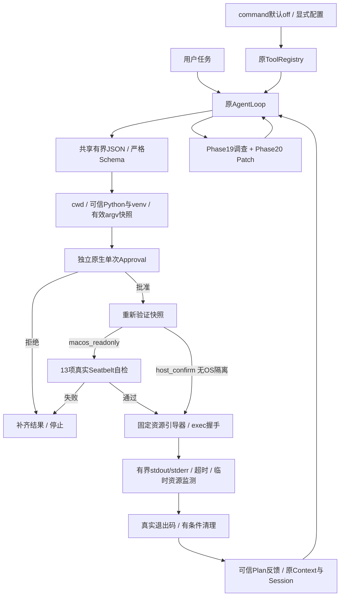

# Phase 21：Terminal Execution, Approval & macOS Sandbox

## 1. 学习目标与事实基线

本阶段在原AgentLoop中新增原生run_command，使Coding Agent能够获取真实测试反馈：测试失败→阅读→精确Patch→再次测试。编辑改变文件，执行运行代码并可能产生副作用，两种能力必须有不同的权限边界。不是完整Autonomous Coding Loop，也没有新增Git Commit/Reset/Push工具或第二套模型循环。

基线为已推送的codex/phase-20 `db50c67`，phase-20 Tag仍固定在`73688da`；main仍`3461dc7`。开发位于独立分支codex/phase-21和APFS工作树`/Users/godblack/.codex/worktrees/phase-21/mybot-mini`。原main的app.py、USER.md和Index保留，不自动合并、不Push、不进入Phase22。

## 2. 配置、注册与默认兼容

完整配置中的可选片段：

```json
{"coding":{"enabled":true,"patch_mode":"write","command":{
  "mode":"macos_readonly","timeout_seconds":30,"max_output_bytes":32768
}}}
```

| mode | 前提 | 权限 |
| --- | --- | --- |
| off（缺省） | 无新增前提 | 不注册run_command，旧Registry/Schema不变 |
| host_confirm | enabled=true且patch_mode=write | 每条明确批准后按当前用户权限执行，没有OS隔离 |
| macos_readonly | enabled=true，兼容preview/write | 每条审批、实际Seatbelt验证后执行；不可用即拒绝 |

command必须对象，严格拒绝未知字段和错误类型。timeout_seconds为整数1–60，缺省30；max_output_bytes为整数4096–131072，缺省32768。模型可降低单次超时，不能提高配置上限，也不能在工具调用里改变mode、环境、用户、输出路径或策略。真实config/config.json未修改。

Gateway显式传递command配置和独立的cli_command_approval；ToolRegistry新增参数均为关键字，旧调用有效。command关闭时不增加Schema，猜测名称也无法执行。Patch preview/write仍真正移除write_file。macos_readonly只约束该命令的子进程，不把所有原生/MCP工具变成只读；patch_mode=off仍保留旧write_file，write仍允许独立的受约束Patch。原MCP Approval、Discovery、OAuth和路由没有被用于伪装本地命令权限。

## 3. argv 与严格输入边界

```json
{"argv":["uv","run","--no-sync","python","-m","unittest","discover","-s","tests","-v"],
 "cwd":".","timeout_seconds":30}
```

只有argv必填；cwd默认`.`。argv为1–32个非空字符串，每项最多2048字符，总UTF8最多8192字节，NUL拒绝。cwd最多4096字符且必须是Workspace内已存在的相对目录；拒绝绝对路径、任何`..`、符号链接目录和旧敏感cwd路径。真正启动前再次验证，不因Git根在父目录而扩大范围。

顶层additionalProperties=false；不接受Shell字符串、stdin、env、profile、身份或关闭审批的参数。原始JSON先限制16KiB，再解析；拒绝重复键（包括Unicode转义后的同名键）、非有限数字、异常嵌套。直接Registry调用再次验证并取得独立快照。共享arguments.parse_object从Phase20解析逻辑抽取，Patch保留256KiB限制和原冲突语义，避免复制另一份解析器。

argv直接交给create_subprocess_exec，没有shell=True或自动Shell替代。但python -c、脚本、import、subprocess都可以执行任意代码；名字白名单、cwd和shell=False不能替代审批或OS隔离。

## 4. 可执行程序与当前项目Python

仅支持python/python3、pytest/ruff（经验证的Python -m模块）及固定形态`uv run --no-sync python ...`，其他命令明确unsupported_command。不搜索仓库PATH，不执行Workspace里的同名python/uv，也不接受任意相对/绝对可执行文件名。

trusted_python以当前宿主的sys._base_executable/sys.base_prefix为信任基线，校验普通可执行文件、所有者、非组/其他人可写、inode/大小/时间。目标Workspace存在`.venv/bin/python`时，要求虚拟环境目录非符号链接、解释器为指向同一可信base的链接、pyvenv.cfg为有界普通文件、home匹配base/bin且include-system-site-packages=false；配置内容纳入快照指纹。否则使用已验证的当前Agent环境。项目依赖及.pth仍属于会被执行的项目代码，不能由名字证明安全。

uv只从固定宿主安装位置解析，链接目标也必须属于允许的宿主根，拒绝Workspace程序。实际命令增加`--no-config --offline --no-sync --python <验证后的Python>`；完整有效argv在审批前显示，不能批准短前缀后暗中换参数。项目venv和Agent运行时只按明确根授权读取，uv可执行文件只授权自身；不开放整个HOME。pytest/ruff需要该环境实际安装，工具不自动安装、同步或联网；模块缺失是实际执行的非零反馈。

## 5. 独立的一次性原生命令审批

CommandApprovalRequest是冻结对象，保存execution_mode、相对cwd、完整有效argv、timeout、os_sandbox和完整JSON展示。参数先独立复制为不可变快照，再等待Provider；批准后重新核对cwd inode、运行时/venv指纹和相同argv，真正执行使用固定目录fd。模型无法通过后续修改参数列表、MCP结果或文字获得批准。

CLI通过独立cli_command_approval接线，与MCP CLI Provider分开。stdin/stdout非交互默认DENY；无Provider、异常、普通True、其他返回值都不算批准，仅接受ApprovalDecision.APPROVE。CLI需要输入精确yes，每次调用独立询问；没有授权缓存、Session恢复授权或/clear恢复授权。取消审批传播CancelledError，此时不启动命令。

审批JSON使用ensure_ascii转义ANSI、换行、控制字符和方向字符。参数出现敏感字段词或凭证标记、完整展示超出12000字符时直接拒绝，不能裁剪或遮蔽后继续执行。有效argv包含解释器/uv自动固定参数；固定资源引导器是工具实现的一部分，不是模型传入的附加命令。展示可能保守拒绝合法的含token/secret等词的测试参数，这是有意的第一版限制。

host_confirm明确警告：进程仍可主动读取用户文件、访问网络、启动其他程序和改变工作区。最小环境不等于OS沙盒，非零退出也不代表没有副作用。

## 6. 最小环境与临时目录

不复制os.environ。固定PATH仅/usr/bin:/bin，传入LANG/LC_ALL、临时HOME/TMPDIR/TMP/TEMP、PYTHONDONTWRITEBYTECODE=1、PYTHONNOUSERSITE=1、禁用pytest插件自动加载、临时XDG/uv缓存、uv离线/禁下载/固定环境配置。API Key、云凭证、代理、PYTHONPATH/PYTHONSTARTUP、DYLD_*和GIT_*不继承。模型不能临时注入其他变量。

临时目录独占创建、权限受限，macOS使用/private/tmp下本次专属路径，结束后清理。HOME不是真实用户HOME。PYTHONDONTWRITEBYTECODE减少正常导入的pycache写入，但程序可以忽略环境变量，真正禁止Workspace写入的是Seatbelt。host_confirm没有这种系统级限制。

## 7. Seatbelt实现与弃用风险

macos_readonly使用实际`/usr/bin/sandbox-exec -p <宿主生成策略>`，不是仅检查可执行文件存在。策略由固定代码生成，模型没有profile参数，不会失败后转为host_confirm。非macOS、策略编译失败、执行/隔离自检失败均fail closed。

Apple明确指出SBPL并非受支持的第三方接口，并解释sandbox-exec已弃用；因此本阶段是当前机器上的实验性、实际验证能力，不承诺未来macOS兼容。[Apple DTS说明](https://developer.apple.com/forums/thread/661939)

本轮实际环境：macOS26.6.2（25G83）、Python3.12.14、uv0.12.10、Git2.54.0（Apple Git-157）、rg15.2.0。Linux/Windows没有新增沙盒实现；其他平台不能将macos_readonly标成成功。

## 8. 拒绝优先的策略范围

- deny default；允许受约束进程启动/fork和少量运行时需要的硬件/系统sysctl查询，不宽泛开放所有sysctl。
- 允许Workspace源码及明确运行时根只读；系统只读根为/System/Library、当前Cryptex usr/lib、/usr/lib、locale、Apple系统库、/bin、/usr/bin。
- 允许必要祖先目录的**literal**读取用于解释器路径解析；不是祖先目录subpath授权。文件metadata可见性较广，祖先目录名称可见，这是明确的信息边界限制。
- Workspace写入显式拒绝，.git/Index也不能写；只允许本次临时目录读写，/dev/null写入是标准IO例外。
- 明确拒绝Workspace常见私密路径（.env、.git、SSH/云凭证目录、credentials、config/config.json）和HOME的SSH/云/Keychain路径读取。不是任意文件内容的完整秘密分类器，不能承诺识别所有自定义凭证文件。
- 网络和Mach服务没有allow规则，包括回环网络。拒绝file-link，阻止临时目录硬链接成为Workspace改写别名；符号链接最终目标仍受内核路径权限限制。
- 显式拒绝process-info*，包括从父进程参数通道读取外部进程信息。单独负例有真实宿主对照。

不允许Workspace选为HOME或包含HOME的宽泛根，也拒绝直接选择HOME私密目录。Workspace与专属临时目录不能重叠。没有用整个用户HOME或整个/System（可能含Data卷别名）作为递归读取许可。

uv/Rust运行时依赖vm.pagesize及兼容页面大小查询；只补充这些具体查询，没有恢复sysctl全开。XNU中兼容页面大小名称与公开名称可能不同，说明系统版本变化需要实际回归。[Apple XNU kern_mib.c](https://github.com/apple/darwin-xnu/blob/main/bsd/kern/kern_mib.c)

## 9. 每次命令的实际隔离自检

批准之后、项目命令之前，verify_sandbox在完全合成目录中运行固定可信探针。即使策略坏掉，也只可能改变合成哨兵，不尝试写真实用户文件。自检不复用命令授权，没有模型请求或外部服务。

| 检查 | 实际要求 |
| --- | --- |
| Python/源码读取 | 启动成功并读出合成源码哨兵 |
| unittest | 真实标准库只读用例通过 |
| 临时数据 | 专属临时目录写入并读回 |
| Workspace源码写入 | EPERM/EACCES，宿主核对原字节未变 |
| Index写入 | 被拒绝，原Index哨兵未变 |
| 外部文件写入 | 被拒绝，原哨兵未变 |
| 外部私密读取 | 被拒绝 |
| Workspace私密读取 | .env与config/config.json被拒绝 |
| Workspace符号链接 | 指向外部仍不能写入 |
| 临时目录符号链接 | 指向Workspace仍不能写入 |
| 硬链接 | 不能创建可用于别名改写的链接 |
| 回环网络 | 宿主先连接真实可达本机服务；沙盒连接必须权限拒绝 |
| 子进程继承 | Python子进程仍不能写外部哨兵 |

CHECKS必须精确匹配13项且全部true，退出码0、exec握手和sandbox_applied真实成立，宿主还会独立检查哨兵。不能用“服务本来未开启”冒充网络拒绝，也不能把只启动sandbox-exec当作隔离成功。

## 10. 生命周期、固定引导器与执行证据

command_process独立于Phase19 readonly_process，后者的固定Git/rg假设未扩大。create_subprocess_exec直接argv、stdin=DEVNULL、独立Session/进程组。先运行可信base Python的-I/-S引导器，避免在限制前导入项目代码；设置资源上限、fchdir到固定cwd fd，随后exec实际批准的argv。

父进程持有内部exec握手管道。引导器先写ready，exec失败会追加failed；成功exec关闭CLOEXEC管道，目标不能继承它来伪造握手。没有握手时不能声称目标启动成功；sandbox-exec策略失败也不会成为普通测试失败。cwd/运行时在审批后和自检后各重新核对，描述符在exec前关闭。

spawned/sandbox_applied描述的是请求的项目命令，不把自检探针的进程启动混入结果。即使exit_code=0，也仅证明该命令正常零退出，不证明整个用户任务已完成。

## 11. 有界输出、时间与临时资源

stdout/stderr各自并行流式读取，每块4096字节，共享配置总字节预算，任一流不能突破总量；超限立即终止本次进程组，返回output_limit_exceeded/output_truncated，不先communicate无界读取。stdout_bytes/stderr_bytes是实际观测到的字节数（可能含触顶时丢弃的一小块），不是声称统计了进程全部潜在输出。

timeout为wall-clock执行预算，默认30最多60；另设置CPU上限timeout+1、单文件RLIMIT_FSIZE=8MiB、NOFILE=128、CORE=0，子进程继承。临时数据每约50ms按不跟随符号链接的fd遍历检查32MiB、512条目、深度16；触顶终止并清理。临时总量是监测阈值而非硬磁盘配额，轮询间可能超出；不提供内存/cgroup/恶意fork隔离。

输出非法UTF8以replacement解码且encoding_replaced=true。控制字符/方向字符转义，不把原始ANSI送到终端；已知HOME/Workspace/运行时/临时路径替换，常见凭证标记脱敏。不是完整秘密脱敏，输出仍为不可信Tool数据，不是System指令。

## 12. 超时、取消与进程组清理

超时、输出/临时预算超限、取消时，只对本次Session的进程组发送KILL，PermissionError时回退本次直接子进程。正常主进程退出后也清理残留的受管理子进程。不按名称杀进程，测试确认无关进程存活。

有界清理等待最多1.5秒，并关闭自己的asyncio管道transport，防止脱组子进程持管道造成永久等待；这使用了asyncio私有transport接口，是版本兼容风险。取消发生在spawn期间也会先取得/清理已创建的进程；清理受shield保护，完成后继续传播CancelledError。取消不是成功ToolResult，原Plan异常结束规则继续生效。

普通killpg不能保证回收主动setsid脱组的恶意后代。本轮有专门的脱组持管道测试，证明工具有界返回；测试自己清理它拥有的合成脱组PID，不能把这当作生产工具具备全后代清理能力。Seatbelt的访问限制仍继承，但它不是VM，也不提供任意恶意程序的完整资源隔离。状态或清理无法确认时返回process_state_unknown，不宣称测试通过。

## 13. ToolResult结构与Planning

output为JSON的stdout/stderr；metadata另含：status、approved、execution_mode、spawned、completed、process_terminated、sandbox_applied、exit_code、command_nonzero、timed_out、output_truncated、stdout_bytes、stderr_bytes、duration_ms、encoding_replaced、execution_evidence。

| 结果 | success | Plan/循环 |
| --- | --- | --- |
| 正常完成且exit_code=0 | true | 命令成功执行证据，可验证当前步骤 |
| 正常完成且exit_code非0 | false | completed=true/command_nonzero=true；清除verified，保留in_progress供调查修复 |
| 拒绝/无法展示/无Provider | false | 不spawn，补齐同批结果并结束任务 |
| 沙盒/启动失败、信号、超时、输出/临时超限、状态不确定 | false | 不提供成功证据，停止后续调用与当前任务 |
| 取消 | 不伪造成功结果 | 清理后传播取消，Plan按原异常规则关闭 |

仅Loop确认真实注册RunCommandTool类型后才使用非零反馈语义，MCP/任意同名Tool伪造metadata不能绕过Plan。没有safe_to_retry，也不自动重复失败命令；非零命令可能已有副作用。Patch的可信原生预览/冲突处理不变。

批量停止沿用原机制，未执行调用仍补齐Tool Call ID。原MCP拒绝文案保留，包括MCP先拒绝、后面排队了run_command的情况；不能把被跳过的命令误报为原生命令拒绝。没有新风险分类LLM请求、第二套ReAct或MCPToolCatalog改动。

## 14. 日志、Context与Session

private_arguments=True复用解析前参数遮蔽；Debug仅工具名、成功/错误和安全计数，不打印完整argv、stdout/stderr或环境。审批界面必须完整展示，和Debug的规则不同；无法安全展示的审批请求直接拒绝。

工具先字节限额，原ContextManager再对模型请求副本裁剪并标记不完整；canonical Session保留原有界工具结果和协议配对，不更改持久化默认值。用户开启Session持久化后，模型发来的原始参数及工具结果仍可能落盘，拒绝秘密参数不等于已经从canonical输入抹除秘密。没有额外命令输出/审批日志或授权缓存；stdout/stderr不能升级成高优先级指令。

## 15. 真实合成项目失败→修复→通过

复用make_demo，额外创建标准库unittest文件，明确从src.calculator导入实际add；选择该测试pattern，避免Phase19教学pytest式文件的导入问题干扰业务断言。宿主固定Git命令只用于准备临时夹具和原有暂存/未暂存/未跟踪状态，不是Agent Tool。

```text
create_plan → 开始步骤1 → run_command（真实失败） → search_code
→ read_file_range（真实SHA） → apply_patch预览 → apply_patch写入
→ 完成步骤1/开始步骤2 → run_command（同一测试） → git_diff → 完成步骤2
```

固定模型从实际exit_code、AssertionError、源码命中与SHA构造后续请求，不能跳过失败或预填哈希。共12次固定模拟模型请求，2次独立合成审批，仅限本次可丢弃fixture；生产CLI仍必须人工批准。

实际结果：修复前`exit_code=1`、断言`-1 != 5`；修改`return left - right`为`return left + right`后，相同unittest `exit_code=0`，1项通过。macos_readonly两次sandbox_applied=true；host_confirm演示两次false，明确不伪装沙盒。Plan完整完成，Tool Call ID配对，原用户注释、暂存README、未跟踪notes及Index字节全部保留。没有真实LLM、Token/费用数据，也不能据此证明真实模型自主修复能力。

## 16. 核心文件和调用链



| 文件 | 作用/关键函数 |
| --- | --- |
| 新增mybot/tools/arguments.py | parse_object共享解码前字节限额、唯一键、类型/深度/有限数检查与快照 |
| 新增mybot/tools/command_config.py | CommandSettings冻结配置、validate_command权限组合校验 |
| 新增mybot/tools/command_approval.py | inspectable_command完整安全展示、authorize_command单次决策、CLI接线 |
| 新增mybot/tools/command_process.py | trusted_python/trusted_uv/resolve_launch固定运行时；run_process引导/握手、双管道、资源与清理 |
| 新增mybot/tools/macos_sandbox.py | profile拒绝优先策略、verify_sandbox真实13项门控 |
| 新增mybot/tools/run_command.py | _cwd、execute协调输入/审批/执行；safe_output数据展示；明确失败结构 |
| 新增scripts/check_command_execution.py | 58项专项，真实进程、合成审批/目录/服务与原Loop |
| 新增docs/phases/phase-21.md | 本学习文档 |
| 修改mybot/config.py | 可选coding.command严格加载，缺省off |
| 修改mybot/tools/registry.py | 显式关键字参数和默认关闭注册 |
| 修改mybot/app.py | 独立原生命令CLI Provider，原MCP Provider保留 |
| 修改mybot/agent/loop.py | 原生解码前限额、可信类型判断、批量停止；MCP文案兼容 |
| 修改mybot/agent/planning.py | 仅真实原生命令非零完成保留调查步骤 |
| 修改mybot/tools/patch.py | 复用共享解析器，其余版本/恢复实现保留 |
| 修改scripts/coding_repo_demo.py | 新--command/--command-mode，原只读/编辑Demo保留 |
| 修改scripts/check_phase.py | 全量接入命令专项 |
| 修改config/config.example.json | 默认command关闭，不修改真实配置 |
| 修改README.md | 使用方式与权限边界 |
| 修改docs/phases/README.md | 真实阶段状态/Tag索引 |
| 修改AI_HANDOFF.md | 当前状态快照 |

## 17. macOS + uv 安装、运行和回归

```bash
uv sync --frozen
git --version
rg --version
uv run python -m scripts.check_command_execution
uv run python -m scripts.check_patch_editing
uv run python -m scripts.check_repository_tools
uv run python -m scripts.check_approval
uv run python -m scripts.check_phase
uv run python -m scripts.test_phase_archives
uv run python -m compileall -q mybot scripts
uv run python -m scripts.coding_repo_demo --command
uv run python -m scripts.coding_repo_demo --command --command-mode host_confirm
uv run python -m scripts.compare_tool_discovery
uv run python -m scripts.compare_tool_retrieval
uv run python -m scripts.compare_adaptive_routing
uv run python -m scripts.compare_selective_routing
```

交互CLI为`uv run python mybot/main.py`，用户自行配置真实LLM凭证、现存Workspace和命令模式；本阶段未执行真实API。Demo是合成项目的测试入口，自动合成审批不能迁移到生产用户目录。pytest/ruff若未安装，不自动联网补依赖。只读模式下测试应把临时/缓存数据放专属TMPDIR，pytest可能需`-p no:cacheprovider`，写回项目文件的测试将按策略失败。

常见问题：approval_unavailable表示没有Provider；非TTY CLI拒绝是预期；sandbox_unavailable时检查平台/当前策略实际验证，不降级；untrusted_virtualenv要求核对venv来源，不运行仓库伪装解释器；timeout_exceeds_configuration不能由模型提高限额；非零输出是调查证据而非通过；truncated时不能声称看完全部错误。

## 18. 当前验证状态

58项命令专项、55项Patch、34项Repository和25项MCP Approval专项通过，mybot/scripts编译通过。包含实际13项沙盒门控、真实可达网络对照、父进程信息拒绝、假程序/venv、审批快照/取消、并发输出、超时/取消/进程组与脱组持管道边界，以及原Loop失败→Patch→通过Demo。最终冻结实现全量569项（511+58）及Phase1/2原断言通过，归档脚本集成通过；正式归档和独立验证将在已提交版本执行。已审查147个源码/文档文件，没有真实配置/凭证/Session/缓存/不必要大文件；原main用户文件和Index哈希未变。

四组旧基准已在Phase20 db50c67和当前源码分别执行，除计时/Git元数据外逐字段相同；默认工具Schema、任务结果与检索/路由指标没有变化。真实LLM和第三方MCP/OAuth不参与验收；旧HTTP/OAuth测试使用localhost合成服务。

## 19. 保证、限制与后续边界

已证明的是本机当前策略下的读写/网络拒绝、逐命令授权、真实有界进程反馈和固定模拟器链路。没有VM、跨平台沙盒、完整秘密脱敏、内存/磁盘硬配额、恶意fork/脱组后代完整清理或所有文件系统竞争防护。运行时和系统库需信任，fd/指纹二次检查与最后exec之间仍有竞争窗口；SBPL和asyncio私有transport都可能随系统升级变化，必须重验，不可用就拒绝。

Phase20只做版本约束编辑；Phase21新增真实命令反馈、独立Approval和经过实测的macOS只读执行。Patch仍在命令沙盒之外执行其独立权限逻辑，执行输出与修改证据分开验证。Phase22的自主任务循环、重试预算与策略尚未实现，当前完成后停止，不自动进入下一阶段。

## 20. 不可变归档与独立复习

只从干净且包含本阶段学习文档的已验证提交保存：

```bash
bash scripts/save_phase.sh 21 "Terminal Execution, Approval & macOS Sandbox"
bash scripts/restore_phase.sh 21
cd ../mybot-mini-learning/phase-21
uv sync --frozen
uv run python -m compileall -q mybot scripts
uv run python -m scripts.check_phase
uv run python -m scripts.coding_repo_demo --command
```

工作树脚本默认将ZIP输出到其同级mybot-mini-snapshots，需核实后独占复制至原项目同级正式快照目录。唯一Annotated Tag为phase-21，任何旧Tag/ZIP不可移动覆盖。ZIP必须CRC、安全清单、必要文件、提交SHA和逐文件核对；正式ZIP独立APFS解压及restore目录均冻结安装、编译、完整回归、旧基准与真实Demo验证。._*不入归档，COPYFILE_DISABLE=1减少元数据，不承诺ExFAT完全不生成。实际提交/路径/哈希与最终记录完成后另列，不能用最新代码冒充历史。

archive-ready: true


## 21. 最终归档与独立还原记录

- 实现Commit：`db50a5da4c86adb4d67704554f170e7655ab92ee`；唯一Annotated Tag `phase-21`准确指向它，Tag对象`678d960adcd93d756314001363dcf2b3cb8a9345`。
- 在干净提交运行save_phase.sh 21；独立冻结安装、编译和569项全量通过后，脚本发布到`/Users/godblack/.codex/worktrees/phase-21/mybot-mini-snapshots/phase-21.zip`，再独占复制至正式目录。
- 正式完整ZIP：`/Volumes/move-disk/data/code/mybot-mini-snapshots/phase-21.zip`；SHA256 `9ee8c896ccef8977b6d5cc5aa0cb1dac9fa24bd9c43345bda53e12f64cfc6e48`。166 entries/147 files，CRC通过，ZIP comment为实现提交，147文件逐字节等于Tag，无AppleDouble、真实配置、凭证、Session或缓存。
- 正式ZIP再次在全新APFS临时目录独立解压，冻结安装、编译mybot/scripts、58命令/55Patch/34Repository/25MCP Approval专项、569全量及Phase1/2原断言全部通过。
- restore_phase.sh 21实际生成学习目录`/Users/godblack/.codex/worktrees/phase-21/mybot-mini-learning/phase-21`。该独立目录同样冻结安装、编译、四项专项与569全量/原断言全部通过；测试后全部147个源码/文档文件仍逐字节等于Tag。
- 两个副本均重跑四组旧基准，除计时/Git元数据外逐字段等于Phase20 db50c67；两种模式的真实Demo完整结果也与开发副本一致：12固定请求、2合成审批，exit1→实际Patch→exit0，1项通过，沙盒版两次true、宿主版两次false，原注释/其他文件/Index保留。
- 最终确切实现的归档脚本集成再次通过，覆盖脏树、非法参数、禁止覆盖、rN修订、ZIP路径穿越/CRC/秘密与Session拒绝。没有真实LLM或第三方MCP/OAuth连接；网络只用本机可达合成服务作为隔离对照及旧回归。
- 原21个历史Tag对象、21份ZIP哈希全部不变；原main仍`3461dc7031bb9542070b034bed0be47f61760f75`，用户app.py/USER.md及原Index哈希与开始一致。Phase19/20及旧学习目录没有覆盖或改写。

本节属于后续纯文档归档记录提交；Tag和ZIP固定在db50a5d，不移动Tag或重导出。保留codex/phase-21工作树供审阅，未Push、未Merge，不进入Phase22。归档中的学习文档已经包含实现/验证与archive-ready；最终发布事实以分支本文及Git记录为准。
