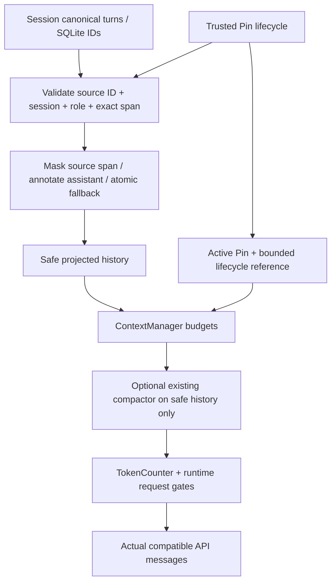

# Disposable projection contract

当前System/受保护规则与当前用户请求不被投影修改。active Pin和宿主生命周期参考都是user-role参考，不增加System授权。实际API顺序仍system、受保护参考、历史/摘要、当前Plan/用户/工具组，不能用概念优先级打散协议。

只有临时copy发生遮蔽/注释；SQLite user.message、assistant.message、Pin source_span及审计事件不变，Session canonical历史也不变。没有修改EventStore或Schema设计。

有界诊断：revoked_pin_count、superseded_pin_count、redacted_source_spans、preserved_independent_user_spans、omitted_protocol_turns、omitted_assistant_messages、omitted_user_messages、omitted_unmapped_turns、source_mapping_failures、固定枚举reason计数及history_projection_incomplete。preserved_independent_user_spans是非空原文连续片段（Python字符串/codepoint切片）数量，不是语义事实数量；5项事实通过独立固定单元逐项检查。

即使投影前后轮数相同，局部遮蔽或助手省略也使history_information_incomplete/context_truncated=true、coverage=unverified。与Token预算造成的history_turns_omitted分开，不把局部遮蔽冒充完整阅读。CLI的PROJECTION行与Web资源面板来自同一resources.context对象，普通SSE只携带计数和reason codes，不携带遮蔽原文。

确定性摘要和已授权的可选语义摘要都接收筛选后的turns。生命周期变化后的安全文本参与摘要cache key；引用仍必须来自真实筛选后来源、user约束只可引用user、completed只可引用非Error tool。摘要失败不修改Pin表，不新增投影分类请求。

生命周期参考也占字符/Token和输出保留预算；模型窗口检查包含它，没有预算旁路。放不下受保护参考时明确拒绝；历史可因预算省略，并维持不完整诊断。未知真实窗口和tokenizer仍未知，strict模式仍拒绝无验证dispatch。
